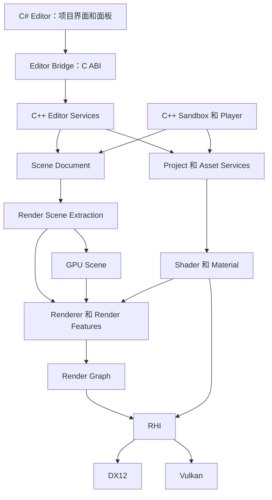
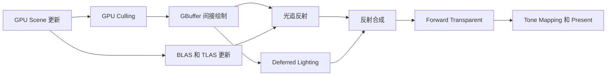

# RenderLab 总体设计

设计日期：2026 年 10 月 23 日。架构已按设计复查收紧状态所有权、资源生命周期、材质布局与扩展边界，后续通过可运行的里程碑验证接口。

本文件维护架构和数据契约。[阶段计划](phaseplan.md) 单独维护实施任务和阶段状态；[设计复查](design-review.md) 记录参考依据、问题与修订结论。

RenderLab 是面向引擎岗和渲染岗求职的渲染引擎项目。核心采用 C++20，支持 DX12 和 Vulkan，统一 Shader 工具链、Shader 驱动材质、声明式 Render Graph，以及可组合的光栅化和光追渲染。GPU Driven 是可选的场景处理与提交方式，可以与不同渲染算法组合。

开发先完成原生渲染运行时和调试工具，再建设 C# 编辑器与完整项目工作流。Project、资源身份和模块边界提前预留；项目面板、文件管理、自动 Inspector 等界面后期实现。

## 目标与范围

核心成果包括双后端一致的资源和命令语义、可检查的 Render Graph 编译结果、可靠的 Shader 与材质热重载，以及有画面和测量数据支撑的渲染专题。

| 领域 | 设计目标 | 实施原则 |
| --- | --- | --- |
| 运行时 | C++20 和现代显式图形 API | 固定现代工具链，明确对象所有权和线程边界 |
| 后端 | DX12 和 Vulkan | 每个关键功能先打通一个后端，再及时验证另一个 |
| Shader | 一份 HLSL，生成 DXIL 和 SPIR-V | 编译目标和功能要求由能力检测决定 |
| 材质 | 从 Shader 元数据生成 Template | 用户直接从 Shader 创建 Material |
| Render Graph | 声明访问，自动生成依赖、同步和执行计划 | 正确性优先，再实现并行录制和多队列 |
| 渲染算法 | 光栅、混合光追、后续完整光追实验 | 共享场景和材质数据，保留各自专用管线 |
| GPU Driven | GPU 剔除和间接绘制 | 保留 CPU 提交路径作为基线和对照 |
| 编辑器 | C# 与 Avalonia，WPF 可作为 Windows 替代方案 | 原生运行时独立于 UI 框架 |
| 项目 | Shader、Material、Scene、Model 等资源的边界 | 先定义身份和目录约定，后实现完整操作界面 |

首期范围以渲染为中心。物理、网络、通用脚本、完整 Prefab 系统、节点式 Shader 编辑器和原生 C++ 动态热重载后置。早期内部接口允许调整，不建立历史 API 或旧资源格式兼容层；仍保留格式版本和清晰诊断。

### 控制复杂度

同一事实只保留一个权威所有者。新增模块先提供具体数据结构和少量函数，出现真实扩展需求后再抽象接口。目录分层不意味着每层都必须有 Manager、Factory、Registry、插件协议和独立 DLL。

- 后端选择只发生在 Device 创建时；上层不重复检查 DX12/Vulkan。功能能力通过明确的 FeatureRequirements 验证，首版默认关闭高级功能，显式开启但不支持时直接诊断；回落路径只在单一策略入口选择。
- 首期一个 Device、一个项目、一个主视口和一条 Graphics Queue。多视图历史数据仍按 ViewID 命名，避免未来改成全局单例。
- Render Graph 是图内同步计划的唯一生成者；RHI 执行计划并验证，不另做隐式自动状态切换。
- Schema 是材质属性的权威描述，Template 是 ShaderPackage 的只读视图，GPU 数据是可重建投影。
- 基础前向渲染先使用普通函数添加 Pass；Feature 注册表和动态模块等到实际需要时再引入。
- 不提前实现执行计划缓存、通用属性表达式语言、跨进程编辑协议、通用资源流送或通用 Job System。

## 总体分层



RHI 定义 GPU 对象与命令语义。Render Graph 编译一帧工作的资源访问和调度。Renderer 决定采用哪些渲染算法。Shader 和 Material 提供 GPU 程序、参数接口与数据。Scene 向渲染系统提取快照，不直接录制 GPU 命令。

依赖保持单向：RHI 不依赖 Render Graph，Render Graph 不依赖具体 Renderer，运行时不依赖 C# 编辑器。调试数据通过快照和事件向上暴露。

## C++ 与 C# 的职责

| C++ 核心与服务 | C# 编辑器 |
| --- | --- |
| RHI、同步、GPU 资源生命周期 | 窗口布局、Docking、菜单和快捷键 |
| Render Graph、渲染算法、GPU Scene | 场景层级、资源浏览和文件操作界面 |
| Shader 编译、反射、材质运行时 | 根据属性 Schema 构建 Inspector |
| 资源导入、Asset Database、序列化 | 导入进度、日志、错误和依赖展示 |
| 场景数据、编辑服务、视口渲染和拾取 | 用户操作、选择状态和 ViewModel |
| 可独立运行的 Player 和命令行工具 | 编辑命令编排与 Undo 的界面交互 |

项目文件操作的入口在 C#，资源身份、引用更新和导入规则由 C++ 服务统一处理。例如移动一个模型时，UI 发起 MoveAsset 命令，由服务处理源文件和元数据，再发布数据库更新事件。这样命令行工具和编辑器使用同一套资源规则。

场景文档和未保存资源由原生编辑服务维护权威状态。C# ViewModel 是界面投影，避免出现两套独立的材质或场景事实源。编辑事务支持连续预览和一次性 Undo 提交。

编辑器阶段先使用进程内原生库与 P/Invoke，桥接接口采用不透明 Handle、固定宽度字段、UTF-8 和明确的缓冲区所有权。STL 容器、C++ 异常和内部对象指针不跨边界。按编辑操作批量交互，不把 RHI 逐个包装成 C# 对象。桥接双方随同一版本发布，不建设跨版本插件 ABI。

完整编辑器阶段再处理 Docking、DPI、输入焦点、鼠标捕获和原生视口托管。Windows 首选 NativeControlHost 托管子 HWND，C++ 使用该窗口创建 Surface；视口内 Gizmo 和调试覆盖由原生编辑器渲染层绘制。独立 Sandbox 使用自己的原生窗口。视口宿主明确窗口所有权和销毁协议，避免窗口销毁后仍提交渲染。

## 渲染方式与能力模型

### 正交的配置维度

光栅化和光追描述图像生成算法，GPU Driven 描述场景处理和命令生成方式。二者分别配置，不设计成三个互斥 Renderer。

| 维度 | 可选项 |
| --- | --- |
| 图像生成 | Forward、Deferred、混合光追、路径追踪实验 |
| 几何提交 | CPU 剔除和直接绘制、GPU 剔除和间接绘制 |
| 执行调度 | 单队列、多线程命令录制、多队列异步执行 |

例如 Deferred 可以搭配 GPU 剔除和光追反射；Forward 可以使用 CPU 提交并启用 Ray Query 阴影。纯路径追踪主要通过加速结构访问场景，不要求使用光栅间接绘制链路。各算法对透明、蒙皮、材质类型等的支持范围分别声明。

这些能力共享基础架构，但仍需各自实现专用资源、Shader、Pass 和同步。提前预留边界可以减少结构性返工，不能保证后续完全不调整接口。

### 设备能力

基础目标是 Windows x64、DX12 和 Vulkan 1.3。Vulkan 基础路径使用 Dynamic Rendering、Synchronization2 和 Timeline Semaphore，并检查具体特性、格式和限制。DX12 的 Shader Model 与可选功能按实际能力验证。

DeviceCapabilities 至少区分：

- 基础图形与计算能力、格式和附件限制。
- 多队列及其实际队列族关系。
- 间接绘制、多绘制、GPU Count Buffer 与可用索引机制。
- 描述符数组、非一致索引、相关数量限制和更新规则。
- 加速结构、Ray Query、Ray Tracing Pipeline。
- Mesh Shader 等后续扩展能力。

高级路径声明所需能力；用户启用后进行验证，诊断列出缺少的功能和限制。默认运行基础光栅路径，自动回落只在配置明确允许时执行并报告最终配置。GPU Driven 首版采用 Compute 和传统间接绘制，不依赖 Mesh Shader。

## RHI

### 对象与命令

| 分类 | 主要对象与操作 |
| --- | --- |
| 设备与展示 | Adapter、Device、Surface、Swapchain |
| 基础资源 | Buffer、Texture、TextureView、Sampler |
| 程序与绑定 | ShaderModule、BindingLayout、BindingGroup |
| 管线 | GraphicsPipeline、ComputePipeline、RayTracingPipeline |
| 命令 | CommandPool、CommandList、Queue、Draw、Dispatch、Copy |
| 间接执行 | DrawIndirect、DrawIndexedIndirect、DispatchIndirect、可选 Count 形式 |
| 光追 | BLAS、TLAS、Build/Update、ShaderTable、TraceRays |
| 同步与分析 | 提交完成点、资源屏障、QueryPool、Debug Marker |

RenderPipeline 是组织渲染算法的上层对象，与 RHI 的 Pipeline State Object 分开命名和使用。

光追对象和命令可以后期实现，基础资源描述从一开始允许表达其用途、对齐、GPU 地址及访问语义。ShaderTable 的布局、对齐和程序标识由后端生成，不假设 DX12 与 Vulkan 的二进制记录相同。

间接绘制提供两后端可映射的公共语义，不直接向上暴露 DX12 任意 ExecuteIndirect 命令签名。跨绘制变化的对象数据通过索引访问 GPU Scene，PSO 和资源布局按批次组织。

### 绑定模型

逻辑上区分 Frame/View、Material 和 Draw/Object 数据。引擎约定映射 HLSL register space、不同资源寄存器类别与 Vulkan set/binding，编译阶段检查冲突。

基础路径使用显式 BindingGroup。高级路径可使用可索引资源表，TextureHandle 等引擎身份不等同于物理描述符索引。逻辑资源表与材质参数接口在早期确定，完整 Bindless 后期按能力启用。

描述符、上传区和 GPU Scene 更新采用安全的帧版本或提交完成点回收。句柄回收包含代际检查；不能在旧帧仍访问时复用物理索引。

### 资源访问与生命周期

屏障描述区分资源用途、Pipeline Stage、读写访问、Texture Layout 语义和子资源范围。后端翻译为对应 API 的状态与屏障。即使状态名称不变，也要处理 Storage/UAV 写入后的内存依赖。

CPU 所有权通过 RAII 管理，GPU 实际销毁按所有相关队列的完成进度延迟。每个工作线程和在途帧有独立命令分配上下文。资源状态以编译和提交计划为依据，工作线程录制时不竞争修改全局状态。

录制上下文持有资源及绑定对象的使用引用，直到提交后交给完成点回收，或命令被取消。资源依赖也需要保活，例如 View 对应的 Texture、TLAS 使用的 BLAS 和动态索引可访问的纹理。已录制未提交的命令同样受保护；取消录制只释放 CPU 使用引用，不伪造 GPU 完成点。

绑定快照从交给录制任务开始保持不变，直至相关提交完成。材质编辑创建新的安全版本。Bindless 资源集合由驻留快照保活，不能把描述符表当成自动拥有纹理的容器。

图外的早期 RHI 示例和上传工具显式提交前后状态与屏障。导入图时交接状态和完成点，导出时返回最终状态和提交结果；不维护第二套猜测式状态机，也不在每个 Pass 后强制恢复默认状态。NVRHI 的命令列表状态边界说明了并行录制时不能依据录制顺序推断全局状态，RenderLab 采用显式计划处理这一边界。[NVRHI 状态管理](https://github.com/NVIDIA-RTX/NVRHI/blob/main/doc/ProgrammingGuide.md)

编译计划中的最终状态不代表 GPU 已完成转换。提交成功后，持久资源所有者保存计划的最终状态及对应提交完成点，供后续导入产生正确等待；编译、录制或提交失败时，不发布未执行计划的最终状态。完成点只描述真实提交，回收必须等待所需队列实际完成。

FrameContext 按自身提交完成点复用，与交换链图像索引分开。窗口最小化或尺寸为零时暂停该视口，重建后使尺寸相关历史失效；首期 resize 可以使用明确的粗粒度等待，但正常逐帧提交不使用 DeviceIdle。设备丢失先保留日志和诊断并退出，不自动重建整个引擎。

M1 采用拥有资源引用的命令包序列，在 Submit 时由后端生成原生命令；提交完成后回收命令包并复用原生命令上下文。绑定描述和快照构造后只读。展示完成与图形提交完成分开处理：DX12 在 resize/关闭时等待 Present 之后的队列尾部，Vulkan 按图像管理展示信号量，并在重建前等待展示队列。最小资源与 API 边界见 [M1 RHI](../docs/m1-rhi.md)。

实现文件按资源、管线、命令提交和展示职责拆分，仍由单一 Runtime 维护提交与退休所有权。公共资源/命令/上传/展示契约分别包含，后端对象声明只在各自实现中共享。示例渲染、验收、Shader 文件读取和宿主展示循环分别组织；不通过拆文件增加新层级或重复状态。具体入口见 [M1 文件职责](../docs/m1-rhi.md#文件职责与依赖)。

显存分配可以采用 VMA 和 D3D12 Memory Allocator；上传、描述符分配、驻留策略、资源池和图内复用仍由引擎管理。帧内临时分配器避免零散堆分配，按实际用途选择 std::pmr。上传、光追 scratch 和资源池记录当前占用与高水位，设置容量上限，并在相关提交完成后按预算或显式请求清理闲置分配。容量不足时明确扩容、分批处理或报错，避免无限增长及每帧缩扩容。

## 场景数据与 GPU Driven

Scene Document 使用稳定对象 ID，运行时使用类型明确的 Handle。每帧提取 RenderSceneSnapshot，Renderer 不在录制期间遍历可被 UI 修改的场景文档。

即使首期使用 CPU 提交，也提前建立可索引的渲染数据：

- InstanceData：当前和历史 Transform、Bounds、MeshID、MaterialID。
- MeshData：顶点和索引范围、布局、LOD 描述。
- MaterialData：材质参数位置、纹理逻辑句柄、特性和分类。
- LightData：光源类型与参数。
- Visibility/DrawData：可见实例、绘制参数与批次信息。

CPU 和 GPU 剔除路径消费相同的场景身份与数据契约。首期只建立当前用到的表和字段，并上传必要数据；LOD、完整 Bindless 和增量更新在对应功能需要时再实现。GPU Scene 是渲染快照的投影，不单独维护第二套可编辑场景。

GPU Driven 的第一条工作流为：

```text
GPU Scene 更新
    → Compute Frustum Culling
    → 可见实例列表与 Indirect Args / Count
    → 按 Pipeline 和材质类别组织的间接绘制
```

首版仍由 CPU 遍历有限的 Pipeline 批次。GPU Driven 并不意味着 GPU 可以任意切换所有图形状态。后续再增加 Hi-Z Occlusion、LOD 选择、压缩和更复杂的批次生成。

DX12 与 Vulkan 的 DrawID、InstanceID、firstInstance 和间接 Count 能力需要逐项映射验证，不能依赖某个后端的隐含行为。传统透明物体先保留 CPU 排序和独立提交路径；蒙皮和动态顶点更新另行声明依赖。

Hi-Z 使用跨帧历史时，规定首帧、相机跳变和分辨率变化下的失效策略。GPU Scene 的更新、剔除结果和间接参数全部进入 Render Graph 访问声明。

## Shader 与材质

### Shader 工具链

ShaderDefinition 是作者维护的 Shader 资产，包含 HLSL 来源、入口点、材质属性、合法变体、Pass 角色和状态选择。初期使用 JSON 元数据加 HLSL，后续可增加语法前端，内部描述保持统一。

元数据生成材质参数声明，再编译各后端和变体，Reflection 校验实际 GPU 布局。作者元数据负责默认值、显示语义、分组、范围、条件显示和资源用途，Reflection 负责实际绑定、布局和阶段接口。

```text
ShaderDefinition + HLSL
    → 参数声明生成
    → DXIL / SPIR-V 编译
    → Reflection 和接口校验
    → ShaderPackage（程序、绑定映射、材质 Schema 和 PackingPlan）
    → MaterialTemplate（包内 Schema 的只读视图）
```

ShaderPackage 包含程序及每个后端、Pass、变体的绑定映射。MaterialTemplate 是包内生成且不可手工编辑的逻辑属性 Schema 视图，不单独引入模板资产 ID、数据库或模板缓存。它不包含固定的后端 GPU 偏移。

每个 Shader 的逻辑属性 Schema 是唯一来源。对于同一后端和同一代 ShaderPackage，MaterialLayout 跨 Pass 和变体保持稳定，禁止条件宏改变材质参数结构。生成器输出声明和 PackingPlan，明确标量宽度、矩阵、数组和纹理引用表示；Reflection 校验所有实际保留的字段，布局不符时报编译诊断，不临时增加逐 Pass 重打包逻辑。

后端对齐差异由各自 PackingPlan 处理，不要求 DXIL 与 SPIR-V 的参数二进制完全相同。材质在当前后端打包后供不同 Pass 使用，参数变化时生成新版本，不为每个变体维护数据副本。不同 Shader 可以有不同布局，GPU Scene 保存布局身份与参数位置；Layout 身份包含后端与包代际，不能跨重载直接复用旧 GPU 数据。

Shader Cache Key 包含传递 Include 内容、元数据、生成器和编译器版本、目标与编译选项。Pipeline Cache 另外管理，持久化二进制缓存按后端、设备和驱动兼容条件使用。

开发模式允许按需后台编译，缺少的组合在准备阶段进入队列，Execute 不编译 Shader 或同步创建 PSO。首次尚无可用程序时，在准备阶段选择预先就绪的错误材质或跳过受影响绘制并报告，已有有效版本继续使用；配置要求严格执行时，在进入 Execute 前终止该次渲染准备。

发布构建按声明的渲染配置检查必需变体清单，缺失时在构建阶段失败。变体上限、合法约束和最终数量可检查，避免为实现便利遍历全部关键字组合。PSO Key 完整包含程序代际、BindingLayout、顶点输入、附件格式、采样数与固定状态，渲染器和材质共用同一个缓存入口。

### 材质模型

| 对象 | 内容 |
| --- | --- |
| MaterialTemplate | 属性 ID、类型、默认值、编辑语义、合法功能和 Pass 契约 |
| MaterialAsset | Shader Asset ID、属性值、纹理引用和功能选择 |
| MaterialRuntime | 已解析参数、资源引用、变体选择和 GPU 绑定数据 |
| MaterialOverride | 可选的逐对象临时覆盖，不复制整个材质资产 |

用户选择 Shader 创建 Material，编辑器由 Template 自动生成 Inspector。材质之间的父子继承后置。资源序列化使用逻辑值和 Asset ID，不保存 GPU 地址或描述符索引。

属性 ID 稳定，显示名和 HLSL symbol 可以分别调整。Template 保留声明属性，允许某个变体没有使用对应属性。普通数值更新参数数据，静态功能选择变体，渲染状态选择影响 PSO Key。对关键字组合提供合法性约束和裁剪，避免枚举所有组合。

Shader Pass 声明 Forward、GBuffer、Shadow 等角色，Renderer 按契约选择程序。Shader Pass 不负责安排一帧的资源生命周期，Render Graph Pass 可以绘制许多材质。Shader 参数通过显式 BindingGroup 或已声明的资源表提供，Frame/View 数据也经过这一通道，不增加绕过图声明的全局 Shader 状态。

### 光栅与光追的材质共享

统一 MaterialSurface 描述 BaseColor、Normal、Metallic、Roughness、Emission、Opacity 等表面属性。顶点/像素着色与 Ray Hit/Query 路径各自准备几何信息，再调用可共享的材质求值代码。Lighting 和 BRDF 也尽量拆成可重用函数。MaterialSurface 不保存已经应用屏幕空间 AO、阴影或 Tone Mapping 的最终照明结果。

首个完整光追管线使用有限的内置材质类别和通用 Hit Group，通过实例身份索引材质数据，不为每个 MaterialAsset 创建 Hit Group。自定义任意命中程序另行扩展。路径追踪的 BSDF Evaluation、Sampling 和 PDF 属于积分器与着色库的契约，不能只复用光栅最终颜色；首版采用简单积分器，有数据证明必要后再选择 Wavefront 等组织方式。

依赖 ddx/ddy 的纹理采样不能原样假设可用于 Ray Shader。定义采样上下文和显式 LOD/梯度策略，让光栅和光追使用各自可用的导数信息。自定义 Shader 声明自身支持的渲染角色；任意光栅 Shader 不保证自动支持光追。

首个光追演示只支持不透明三角形和基础 PBR。Masked 后续通过相应命中或查询逻辑处理，透明材质单独定义策略；缺少角色时显示明确诊断或选定的替代材质。

### 热重载

后台编译新一代 ShaderPackage，完成接口和相关对象准备后，在安全的帧边界整体切换。失败继续使用上一版，旧 GPU 对象等待所有相关提交完成后回收。

新增属性采用默认值，同 ID 同类型保留已有值，不兼容变化报告诊断。异步编译结果带版本，过期结果不能覆盖更晚的源码。需要切换 PSO、BindingLayout 或光追 ShaderTable 时一起处理依赖。

## Render Graph

### 定义与每帧实例

参考 Unity 的声明式资源访问方式，Pass 通过 Setup 声明所使用的资源，通过 Execute 录制命令。Unity 的图系统也以资源声明组织生命周期和同步，RenderLab 采用自己的 C++ 接口与能力范围。[Unity Render Graph 介绍](https://docs.unity3d.com/6000.0/Documentation/Manual/urp/render-graph-introduction.html)

“定义一次”指 Pass 的实现和访问规则编写一次。每帧仍需绑定当前交换链图像、历史资源、分辨率和实际功能分支，得到本帧图实例。图句柄仅在对应构建和执行周期内有效，不能保存在跨帧对象中复用。

先每帧构建和编译逻辑图，测量 CPU 成本后再按结构与配置缓存执行计划；分辨率、功能、队列或接口改变时重新验证。

PassData 由图拥有或复制到图执行周期的内存区，Execute 使用稳定快照和按值捕获。Setup 中的局部变量引用、临时 span 和局部容器不能被延迟回调持有。Pass 注册处记录名称和 std::source_location，错误可以回到声明位置。图内资源只在声明它的 Execute 中解析为 RHI 对象。这类生命周期约束也见于 Unreal RDG 的延迟执行设计。[Unreal RDG](https://dev.epicgames.com/documentation/en-us/unreal-engine/render-dependency-graph-in-unreal-engine)

### 访问声明

声明至少包含资源、子资源或 Buffer 范围、读写模式和具体用途。Texture 优先支持 mip、layer 和 aspect。Buffer 首版保守按整资源跟踪，接口保留范围描述；细粒度区间调度有收益后再实现。常见用途如下：

| 用途 | 含义 |
| --- | --- |
| SampledRead / UniformRead | Shader 采样或常量读取 |
| StorageRead / StorageWrite / ReadWrite | Compute 或其他 Shader 的存储访问 |
| ColorAttachment / DepthStencilAttachment | 附件读取、写入和清除 |
| CopySource / CopyDestination | 资源拷贝 |
| VertexRead / IndexRead | 顶点和索引访问 |
| IndirectArgumentRead | GPU 生成参数后的间接命令读取 |
| AccelerationStructureBuildInput / BuildWrite / Read | 加速结构构建及遍历 |
| ShaderTableRead | 光追管线读取记录表 |

普通 Pass API 隐藏后端屏障细节，同时利用 Pass 类型与用途推导阶段和布局；需要精确控制的访问提供显式阶段信息。光追构建的 scratch、输入几何、实例数据、目标 AS 和 ShaderTable 都必须计入依赖。Vulkan 对这些资源有专门的同步语义，不能当成普通纹理读写处理。[Khronos 光追指南](https://docs.vulkan.org/guide/latest/extensions/ray_tracing.html)

逻辑写入生成资源版本，编译器还要保留物理资源上的 RAW、WAR、WAW 约束。版本编号并不意味着原地修改自动变成独立资源。附件 Load、Clear、Store 和深度/模板各自的访问要明确表达。ReadWrite 与部分写入保留旧内容依赖，整资源覆盖或 Clear 才可声明丢弃旧值；声明覆盖不代表图能静态证明 Shader 确实写满范围。

绑定资源同样必须声明。对于动态索引的 Bindless 表，不能仅靠单个句柄推断 Shader 实际访问集合：由 GPU Scene 或资源驻留服务提供保守资源集合与生命周期约束；其中动态写入的资源还要显式声明。调试模式检查声明、绑定和命令使用是否一致。

### 编译流程

1. 验证句柄、用途和设备能力，检查访问声明是否完整。
2. 构建资源依赖以及显式的外部顺序依赖。
3. 从导出输出、Present、Readback 和其他副作用根节点剔除无效工作，验证保留访问的初始化要求。
4. 确定合法的 Pass 顺序、队列分配和跨队列依赖，形成执行先后关系。
5. 基于该执行关系计算资源生命周期，安排兼容资源池和可用的内存 Alias。
6. 分配物理资源，生成状态屏障、Alias 屏障、跨队列等待和命令录制批次。
7. 准备所需 View、绑定快照和已就绪的 Shader/PSO，冻结可录制执行计划。
8. 录制并提交命令，发布成功提交的资源状态与完成点，记录调试信息。

Imported 资源描述初始状态、外部完成点、所有权和最终需求。History 由跨帧资源管理器持有，再导入本帧。外部写入、Present、Readback 等副作用显式标记，不能被剔除。Import 只表示外部所有权，不自动把所有使用该资源的 Pass 标为不可剔除。

先实现资源池，再实现同一帧的物理内存 Alias。多队列下，拓扑排序中的先后位置不能证明两个资源不重叠；Alias 必须基于实际执行的 happens-before 关系。首个 Alias 实现只利用已有执行关系，不为节省内存额外串行化 Pass。后续若要联合优化内存和调度，必须先更新执行关系、重新验证生命周期，再重新生成同步计划。

### 自动并行化的边界

| 层级 | 图系统的职责 | 限制 |
| --- | --- | --- |
| CPU 多线程录制 | 把可录制工作分派给独立 CommandContext | 需要线程安全快照、局部分配器和无副作用的录制代码 |
| GPU 多队列 | 将适合的 Compute/Copy 放到兼容队列并生成等待 | 实际重叠取决于依赖、队列、硬件与带宽 |
| GPU 内部执行 | 提供足够并行工作并避免过度屏障 | Shader 内部算法和硬件调度不由图自动改写 |

没有资源依赖不等于可以无条件并行。只读共享也要满足兼容状态、布局和队列所有权要求；有副作用的工作需显式顺序约束。GPU 顺序有关联的 Pass 也可能在 CPU 上提前并行录制，只要资源和执行计划已确定。

Pass 提供队列兼容性和 AsyncEligible 等提示，编译器决定合法调度。TraceRays 不预设只能在 Graphics Queue，按后端与设备支持的队列命令能力安排。首版全在 Graphics Queue 上执行，后续策略提供开关和性能测量。

Execute 只读取声明的数据并录制命令，使用预先准备的 View、绑定和程序，不进行会改变执行计划的资源创建、同步等待或全局状态修改。录制用的临时命令内存由局部上下文提供。原生逃生接口首版不公开；接入外部 SDK 确实需要时，新增有边界的 ExternalPass，完整声明资源、前后状态和队列需求，并限制优化范围。仅把 Pass 标为 Unsafe 无法补回缺失依赖。

### 调试输出

至少能导出 Pass 依赖、资源版本、用途、生命周期、队列分配、屏障、等待点、剔除原因、内存分配与耗时。早期先使用日志和文件导出，后期接入可视化面板。增加单队列串行、禁用剔除、禁用 Alias 等诊断开关，共用同一套编译与执行代码，不长期保留第二套立即渲染实现。

## 光追路线

BLAS 管理几何，TLAS 管理场景实例；通过统一的 InstanceID、MeshID、MaterialID 找到 GPU Scene 数据。BLAS 和 TLAS 在跨帧管理器中持有，构建与更新通过图声明，不能每帧无条件重建全部结构。

静态网格先构建一次 BLAS，Transform 变化更新 TLAS。动态几何和蒙皮涉及顶点更新、BLAS Build/Update 与 TLAS 的先后关系，并受构建标志限制。以后再增加压缩、异步构建和更细的更新策略。

实施分两条能力：

- Ray Query：在图形或计算 Shader 中进行查询，先用于混合阴影或 AO 等简单效果。
- Ray Tracing Pipeline：引入 RayGen、Miss、Hit Group 和 ShaderTable，用于反射或路径追踪实验。

两者都依赖加速结构，但设备能力分别检测。完整光追作为正式目标保留，第一阶段只完成最小可验证样例。路径追踪的采样序列、累积和降噪是独立渲染功能；相机、场景、材质或分辨率变化时明确失效历史。

渲染图描述可静态组织的 GPU 阶段，射线遍历、路径队列和逐路径分支留在 Shader 与积分器内部，不为每条射线生成图节点。GPU 生成的数量通过间接执行或有界 Dispatch 消费，不在热路径读回 CPU 再决定本帧命令。射线 Payload 和队列元素只携带后续工作必需的数据，避免把完整表面对象跨阶段搬运。组织方式以正确的简单基线为起点，测量分支、寄存器和内存流量后再拆分。[pbrt GPU 任务组织](https://pbr-book.org/4ed/Wavefront_Rendering_on_GPUs/Mapping_Path_Tracing_to_the_GPU)

## 可组合渲染管线

RenderPipeline 是组织渲染工作的 C++ 入口；RenderFeature 表示一组相关 Pass 的构建逻辑。首期以普通函数和有类型的输入输出结构添加 Pass，配置只选择编译进程序的功能和参数。需要复用与状态封装时再提供具体 Feature 对象，不要求共同虚基类、全局注册表或动态插件。

候选 Feature 包括 Depth、Shadow、GBuffer、DeferredLighting、ForwardOpaque、ForwardTransparent、IBL、SSAO、Bloom、ToneMapping、GPUCulling、AccelerationStructureUpdate 和 RayTracedEffect。

Feature 之间使用明确契约，例如 GBufferResources、ShadowResources、SceneData。资源格式、法线空间、运动矢量和深度语义属于契约的一部分。按相机与渲染功能传递本帧上下文，不通过任意字符串访问全局资源，也不把每个辅助函数拆成一个 Graph Pass。只有资源依赖、执行类型或独立调度确有需要时才增加 Pass。

一个后期混合示例是：



图中的分支表达潜在调度空间。实际是否重叠由资源声明、队列能力和测量结果决定。

## Project 与资源

ProjectManifest 定义项目 ID、引擎版本要求、资源根目录、启动场景和渲染配置。AssetDatabase 管理稳定身份、路径、类型、依赖和导入产物。初期用简单文件和轻量索引即可，完整数据库与编辑界面后置。

```text
ExampleProject/
  Example.rlproject
  Assets/
    Shaders/
    Materials/
    Scenes/
    Models/
    Textures/
  ProjectSettings/
  Source/
  Library/
  Builds/
  UserSettings/
```

Assets 和元数据、ProjectSettings、Source、项目文件纳入版本管理。Library 是可重建产物，Builds 和 UserSettings 通常忽略。资源引用使用 UUID 和稳定子资源 ID，路径仅表示当前位置。移动资源保留身份，复制资源生成新身份，重复 UUID 报告诊断。

导入缓存键包含源内容、导入设置、Importer 版本和依赖产物。模型生成 Mesh、材质等子资源，保留稳定映射。用户材质覆盖与模型导入产物分开存储，重新导入不能覆盖手工编辑内容。

引擎内置资源和项目资源使用明确挂载根，不把开发机器绝对路径写入资产。首期通过命令行或原生 Sandbox 读取最小项目描述即可。后期 BuildService 从入口场景和显式包含项收集依赖，运行包使用处理后的资源，不依赖编辑器缓存目录。

## 坐标与数据约定

首版统一右手世界坐标，Y 向上，相机前方为局部负 Z，长度单位为米。数学约定使用列向量，GPU 矩阵布局由明确生成与上传规则验证。两后端最终使用 0 到 1 的深度范围，采用 Reversed-Z，远端为 0，近端为 1。

投影、Viewport Y、屏幕 UV 和正面绕序统一在平台适配规则中处理，上层不分散添加 Vulkan 或 DX12 修正。纹理上传、渲染附件和屏幕采样的原点转换用测试图验证。深度重建、阴影和 Hi-Z 都遵守相同约定。

光照在统一的线性工作空间计算，颜色纹理按声明进行 sRGB 解码，法线和普通数据纹理使用线性数据。HDR 中间结果在输出阶段进行曝光、Tone Mapping 和显示编码。

Object、View、Projection 的历史值、相机 jitter 和运动矢量采用明确语义。即使 TAA 后置，也避免在接口中混淆当前与历史变换。

## 工程组织

沿用当前 src、design、docs、manual、tests 的顶层目录，后续按职责增加子目录。

编码、换行、源码格式和命名以 [工程约定](../manual/conventions.md) 及根目录 EditorConfig、Git Attributes、clang-format 配置为准。基础规则采用 UTF-8 无 BOM 与 LF，自有 C++ 的 MSVC 构建显式启用 `/utf-8`。

```text
RenderLab/
  design/                  架构与设计决策
  docs/                    模块接口与技术文档
  manual/                  构建和使用说明
  src/
    core/
    platform/
    rhi/common/
    rhi/dx12/
    rhi/vulkan/
    shader/
    material/
    rendergraph/
    scene/
    renderer/
    assets/
    project/
    editor_services/
    editor_bridge/
    tools/
    apps/sandbox/
    apps/player/
    editor/                后期 C# 与 Avalonia
  shaders/                 引擎内置 Shader
  sample/                  演示项目
  tests/
  cmake/
  external/
```

构建采用 CMake Presets、C++20 和固定依赖版本。第三方优先使用 DXC、volk、VMA、D3D12 Memory Allocator、Dear ImGui 和一个 glTF 导入库。窗口层先满足 Windows 原生宿主，后续根据需要引入 SDL3。C# 编辑器单独构建，通过统一脚本编排。

Concepts 用于有价值的泛型约束，std::span 用于非拥有视图，std::jthread 等用于明确生命周期的后台任务。动态后端边界可以使用虚接口或函数表，帧内高频数据路径尽量采用紧凑数据结构。C++ Modules、协程和通用 Job System 根据真实需求引入。

## 分阶段实施

实施任务、依赖、验收条件和状态统一保存在 [phaseplan.md](phaseplan.md)。按基础运行时、声明式渲染、完整画面、高级能力和编辑器逐步推进，各子阶段独立验证。光追的 AS/Ray Query、TraceRays 和效果集成分别交付；间接提交、GPU 剔除、CPU 并行录制、GPU 多队列和内存 Alias 也分别验证。阶段完成后在计划中保留简短结果和验证入口，把长期有效的接口与使用说明移入 docs 和 manual。

## 验证与展示

CPU 逻辑测试集中在 Render Graph 的依赖、资源版本、剔除、生命周期、多队列 Alias 合法性，以及 Shader 缓存和材质布局。RHI 小场景验证 Compute 写后采样、间接参数写后执行、AS 构建后读取、跨队列传递、延迟销毁和连续 resize。

画面回归固定场景、相机、随机序列和曝光。同一后端检查回归，跨后端使用明确误差阈值；不要求逐像素相同。光追路径同时检查累积失效、材质支持范围和静态/动态场景更新。

性能测量记录 GPU、驱动、分辨率、配置、CPU/GPU 帧时、Pass 耗时和内存。比较 CPU 与 GPU 剔除、单队列与异步调度、资源复用前后的收益；功能开关能够回到基线。调试层开销与正式性能数据分开说明。

项目展示最终应包含可运行包、演示场景、架构说明、Render Graph 调试输出和 PIX/RenderDoc Capture。求职讲解从画面出发，能够追踪到 Shader 接口、场景数据、屏障和 GPU 提交。

## 参考项目与设计取舍

- [Unity ShaderLab Properties](https://docs.unity3d.com/6000.0/Documentation/Manual/SL-Properties.html)：参考 Shader 暴露属性和材质数据的使用方式。
- [Unity Render Graph](https://docs.unity3d.com/6000.0/Documentation/Manual/urp/render-graph-introduction.html)：参考声明式访问和图管理资源的工作流；本文的并行调度规则是 RenderLab 的设计。
- [O3DE Material Type](https://docs.o3de.org/docs/atom-guide/look-dev/materials/material-type-file-spec/)：参考属性 Schema 和 Shader 输入映射。
- [NVRHI](https://github.com/NVIDIA-RTX/NVRHI)：研究显式 API 绑定、资源生命周期和后端边界，自行实现 RenderLab 所需的 RHI。
- [Falcor](https://github.com/NVIDIAGameWorks/Falcor)：参考可组合 Render Pass 与渲染实验工作流。
- [Khronos Ray Tracing Guide](https://docs.vulkan.org/guide/latest/extensions/ray_tracing.html)：用于核对加速结构、Ray Query、TraceRays 与同步边界。
- [Microsoft Indirect Drawing](https://github.com/microsoft/DirectX-Specs/blob/master/d3d/IndirectDrawing.md)：用于核对间接命令语义与跨后端公共范围。
- [Unreal RDG](https://dev.epicgames.com/documentation/en-us/unreal-engine/render-dependency-graph-in-unreal-engine)：参考延迟执行、参数生命周期和声明式依赖。
- [Filament FrameGraph](https://google.github.io/filament/notes/framegraph.html) 与 [Material Guide](https://google.github.io/filament/main/materials.html)：参考小型图模型、材质定义和变体边界。
- [pbrt GPU Rendering](https://pbr-book.org/4ed/Wavefront_Rendering_on_GPUs/Mapping_Path_Tracing_to_the_GPU)：参考离线积分器的 GPU 数据组织，避免把实时 Pass 和逐路径调度强行统一。

开发 GPU、驱动、SDK 与 Shader 编译器通过基础设备报告和双后端最小样例验证。最小 RHI 的具体接口与限制见 [M1 RHI](../docs/m1-rhi.md)，各阶段实际完成状态与硬件证据以 [阶段计划](phaseplan.md) 为准。
