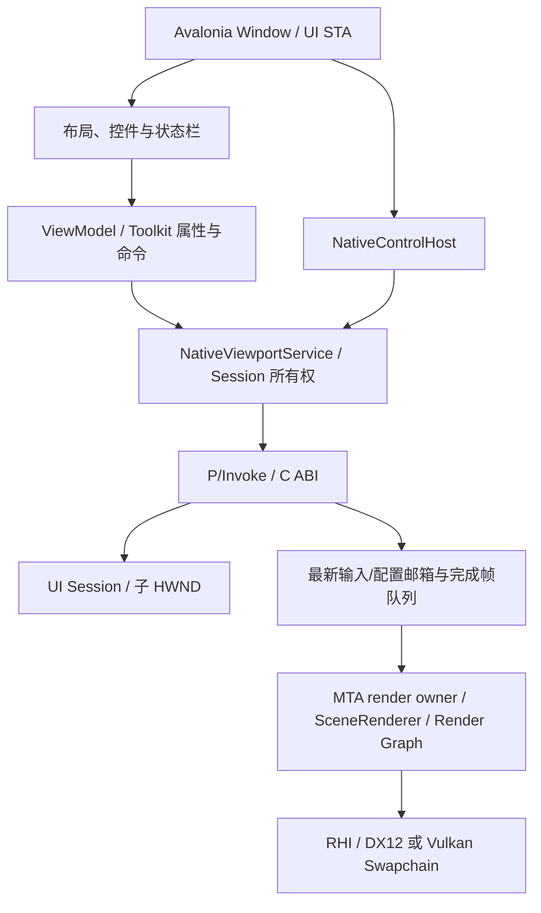

# Avalonia 原生视口原型

本原型验证 Windows x64 上 Avalonia 12.0.5 / .NET SDK 10.0.401 与 RenderLab 原生运行时的进程内集成。构建、运行和自检入口见 [使用说明](../manual/build.md#avalonia-嵌入原型)。阶段状态与实际验证范围统一见 [M7.1](../design/phaseplan.md#m71-桥接与视口试验)。

宿主作为后续 Editor 的基础继续复用。[固定场景渲染工作台](editor-workbench.md) 定义 Dock、运行配置、Graph 与性能观察，再推进材质、项目和场景编辑；这些工作不改变现有 C++ 场景文档的权威所有权。以下记录已实现的宿主接口，工作台设计中的其余扩展按阶段计划逐步接入。

## 官方模板、MVVM 与 DI

宿主以官方 `Avalonia.Templates` 12.0.5 的 `avalonia.mvvm` / CommunityToolkit 模板生成结果为基线整理，保留 .NET 10、App XAML、Views/ViewModels、编译绑定、Inter 字体和 Debug 开发工具。复现参考骨架的命令见 [构建说明](../manual/build.md#avalonia-嵌入原型)。模板来源为 [Avalonia.Templates](https://github.com/AvaloniaUI/Avalonia.Templates)，DI 使用方式参考 [Avalonia 官方指南](https://docs.avaloniaui.net/docs/app-development/dependency-injection)。不引入模板中的空 Models 目录、空 ViewModel 基类或当前未使用的反射 ViewLocator。

| 位置 | 职责 |
| --- | --- |
| `Program.cs` / `Configuration/EditorOptions.cs` | 模板式 `BuildAvaloniaApp` 入口、命令行参数和启动错误处理 |
| `App.axaml` / `App.axaml.cs` | 主题、DI composition root 与应用退出释放；容器仅在这里解析服务 |
| `Views/MainWindow.axaml` | 布局与带 `x:DataType` 的编译绑定，避免业务控件的状态/命令散落在事件中 |
| `Views/MainWindow.axaml.cs` | DataContext、NativeControlHost 挂载/移除、窗口关闭等视图生命周期 |
| `ViewModels/MainWindowViewModel.cs` | CommunityToolkit.Mvvm 生成的可观察属性、RelayCommand、状态展示与配置失败回滚；不调用 P/Invoke，不保存 HWND |
| `Services/NativeViewportService.cs` | 原生 Session 所有权、已接受的视口配置、帧统计/错误和关闭报告；不持有 Avalonia 控件 |
| `Controls/RenderViewportHost.cs` | Avalonia 父 HWND 的创建/销毁回调、控件可见性与输入/统计 Timer 适配 |
| `Interop/NativeMethods.cs` | 固定 C ABI 的 P/Invoke 和数据布局 |

`App` 通过 `Microsoft.Extensions.DependencyInjection` 10.0.0 注册 EditorOptions、视口服务、ViewModel 和窗口；构造器接收依赖，不在 ViewModel/控件中访问全局 ServiceProvider。CommunityToolkit.Mvvm 固定 8.4.1，包图继续进入锁文件。当前单窗口、单视口采用应用级单例，退出时在 UI 线程 Dispose；多视口阶段应为每个视口建立独立的服务实例或作用域，不能让两个 Host 共用同一个活动 Session。

根目录 `RenderLab.slnx` 组织托管项目与构建入口文件，实际应用为 `src/editor/managed/RenderLab.Editor/RenderLab.Editor.csproj`。原生桥接单独位于 `src/editor/native`，原生输入回归位于 `tests/editor/native`。公共 SDK 与 C# 输出约定位于根目录，应用产物写入 `out/dotnet/RenderLab.Editor`，不在源码树生成 bin/obj。NativeMethods 位于 Interop，启动选项位于 Configuration，日志与自检位于 Diagnostics；这些文件夹使用对应命名空间，应用命名为 `RenderLab.Editor`。

未来的 Inspector、Hierarchy、Assets 面板各自增加 View/ViewModel 和所需服务，并由此 composition root 注册。UI 的选择与展示状态放在 ViewModel；场景、材质、资产与 Undo 事务仍由相应原生编辑服务维护。当前不增加通用模块加载器、消息总线、空面板或编辑器插件协议。

## 窗口与渲染的边界

整个编辑器窗口、布局和普通面板由 Avalonia 管理。中央 `RenderViewportHost : NativeControlHost` 向 C++ 请求一个子 HWND，C++ 在这个窗口上创建 Swapchain；图形 API 不经过 C#。原型布局包含管线选择、曝光、暂停、重置相机、重建视口、可拖分隔条和焦点测试文本框。

视口的光栅阴影默认使用 1024² 分辨率，不改写场景保存值；过滤与单张方向光阴影的限制见 [阴影说明](m4-shadows-alpha.md)。

Avalonia 提供宿主父窗口，Bridge 创建并拥有真正的渲染子 HWND。父窗口可以是 Avalonia 的内部托管窗口，不假定它就是顶层窗口；自检验证渲染 HWND 确实属于顶层窗口的子树。独立 Sandbox/Player 继续使用自己的窗口，不依赖 Avalonia。

普通 Avalonia 控件不能可靠地覆盖子 HWND 的像素区域，即原生窗口的 airspace 限制。视口内 Gizmo、选择框、文字和调试覆盖层应由原生渲染层绘制；本原型尚未接入这些编辑能力。若未来需要任意 Avalonia 控件覆盖视口，应单独验证共享纹理合成及 GPU 同步，再决定是否更换展示方案。

## 所有权、调度和销毁

UI STA 创建并拥有子 HWND，接收 Win32 输入，查询真实客户区像素、焦点、捕获、可见性和 DPI。Create 只创建窗口和启动线程；Device、Runtime、SceneRenderer、Swapchain 的创建、使用和销毁全部发生在专用 MTA 渲染线程。现有 RHI owner-thread 检查保留，后台调用 UI Session API 仍返回 RL_WRONG_THREAD。

UI 的 Update 只发布最新尺寸/按键/暂停快照和累计鼠标旋转，不做 GPU 等待。邮箱固定大小，尺寸和配置只保留最新值，重置请求用计数保留，旋转增量在消费前累加。渲染线程不遍历 UI 控件；相机/Scene Document 仅在它自己的帧边界修改。可用管线在初始化时验证并发布，后续 Configure 先校验已知结果再排队；初始化完成前的有效配置若最终不受支持，会通过后续轮询报告启动错误。接收配置不代表首帧已完成，界面和自检以 Stats 的实际管线为确认。

默认目标为 60 FPS，可用 --target-fps 设置 1–240；设为 0 时取消 CPU 限速，并使用非 VSync 展示。DX12 使用 Present(0)，支持时启用 tearing；Vulkan 优先 Immediate，其次 Mailbox，两者均不支持则明确报错。基于 steady_clock 截止时间、高精度 Win32 waitable timer 与可唤醒事件，不依赖 DispatcherTimer 的回调速度；有目标帧率时 VSync 保留，目标是上限，不保证显示器实际扫描速率。慢帧后重设截止时间，不补交突发帧。UI Timer 只适配窗口状态、输入与统计轮询。

连续 Resize 在 60 ms 内合并，稳定后使用最新真实像素尺寸重建一次，避免逐消息 WaitIdle。首次尺寸立即应用；隐藏、最小化、暂停和零尺寸不提交。恢复、WM_PAINT、相机输入、配置和重置会触发重绘。Forward/Deferred 无变化后进入 Idle，RayTracing 在未达到 Renderer 的 MaxReflectionSamples 上限时继续累积。Benchmark 显式连续刷新，以便相同静态场景仍可测量。

Close 首先停止 UI Timer，再通知渲染线程停止，等待其释放展示/GPU、清空资源并发布关闭账本，最后由 UI 销毁 HWND。等待线程期间仅服务 Win32 同步 sent messages，不运行 Avalonia Dispatcher 或 posted 回调；这是防止 DXGI 在创建/销毁 Swapchain 时同步等待窗口线程造成死锁所必需的握手。初始化/渲染异常保存在 Session 中，经 UI 轮询转换为 C ABI 错误；失败后仍可关闭。GPU/编译已在进行时，关闭仍可能等待该操作结束；未实现设备丢失恢复或强制终止线程。

每个 Host 保存自己的 Session 代际。旧 Host 重复关闭不能销毁新 Session；重建保留已接受配置。服务不使用可能在 finalizer 线程执行 Destroy 的 SafeHandle。

## C ABI v6、运行配置与诊断

头文件为 src/editor/native/editor_bridge.h，托管声明为 Interop/NativeMethods.cs；DLL 和托管程序同版本发布。固定 Cdecl、UTF-8 借用字符串、代际 uint64 Handle、线程局部错误缓冲区。创建参数包含 backend、validation、profiling、target_fps 和 continuous。最多四个 Session 的句柄槽位仍是原型上限，多视口并发并未验收。M7.2a 升为 v5，新增 Stop（退休但保留 Session 以收取末尾日志）、批量 UTF-8 JSON 日志读取和相机 pose 值传递；原有 Stats/CloseReport 大小不变。日志容量查询钉住批次，成功复制后才消费，随后 Destroy 使旧 Session 失效。

Dock.Avalonia 12.0.0.2 使用固定面板身份和受限版本化布局数据。默认只有 Scene/Render Settings，其他面板从 Window 菜单打开。根导航指向直接包含的完整工作区；Document.Context 保存面板 ID 与 View 工厂，每个 presenter 创建自己的控件，共享 ViewModel/服务，避免浮动或重建时复用已有可视父节点的 Control。新 Host 先退休仍活动的旧 Session，旧 Host 随后的关闭由代际校验拒绝。Scene 跨父窗口经过 NativeControlHost 的销毁/重建，保存相机 pose 与完整运行配置。布局切换和浮窗关闭沿用 owner-thread GPU 退休及受限 Win32 握手，仍可能短暂阻塞窗口线程；计划中的异步设备重建在 M7.2c，不以本轮浮动成功代表无停顿迁移。

Editor 托管日志接入 Serilog 4.2.0、Extensions.Logging 9.0.0 和 File 7.0.0，输出目录的 logs 保存 UTC 结构化滚动日志。有界内存投影供 Log Dock 按级别/来源/文本查看；C++ Logger 可选有界镜像，UI 批量读取后以原时间/级别/Session/序号汇入。关闭面板继续记录，清空显示保留累计错误数，原生关闭后先 drain 再 Destroy。基础 Profiler 当前只展示既有宿主统计，Graph 数据查看仍待 M7.2d，不把面板骨架当作 Viewer 已完成。

M7.2b 将桥接升为 v6。Stats 顺序布局 256 字节，在原 232 字节字段后加入 config_revision、gpu_config_revision、session_generation；CloseReport 仍为 24 字节，最后一个 uint32 为 worker_failed，异步渲染/初始化/关闭失败时置一，不把失败关闭当作成功。字段包括 Native Tick、Fence、Acquire、Render、Present、Resize、Diagnostics、Graph Compile/Prepare/Record、CPU 场景准备与建图、已完成 GPU Pass 总时间及源帧，另有原生帧间隔/完成时间、样本丢弃计数、activity/ready、UI/render 线程 ID。activity 为 0 初始化、1 活动、2 空闲、3 暂停、4 等待尺寸稳定。所有字段跨边界均为固定宽度数值。

`rl_viewport_config` 为 size/version=112/1 的定宽配置，包含管线/提交/线程/队列/Alias/调试视图、profiling/目标帧率/连续刷新、反射 flags、阴影、导航速度与照明/环境/曝光覆盖。原生校验枚举、布尔、容量与有限数值后接受单调递增 request_id；渲染 owner 复用 SceneRenderer::ValidateOptions 检查能力与材质/场景限制，再替换本视口选项。光照/环境/曝光只覆盖提取后的 Snapshot，源 Scene/Material 不变；相机继续由原生导航所有。

`rl_viewport_config_state` 为 272 字节，携带 requested/applied 配置与 requested/applied/rejected/superseded ID。status=0 初始化、1 Pending、2 Applied、3 Rejected。Applied 只在该配置成功 Render/Present 后发布；暂停时可准备配置但保持 Pending，恢复或 Single frame 后确认。原生初始化发布只读设备/管线/提交能力 JSON 和从场景提取的 defaults，配置拒绝文本使用独立有界复制接口。后端与 Validation 仍为创建参数，本轮不接入 M7.2c 的图形 API 切换。

目标帧率 0↔非 0 会在 render owner 退休并重建 Swapchain，失败先尝试恢复原展示模式；不创建第二个 Device。非 0 帧率间切换只更新调度期限。单帧要求暂停的 ready Session，隐藏/最小化时不强制 Present。宿主重建保存完整运行配置与相机，新 Session 重新校验后应用；UserSettings/Editor/render-preset.json 只保存有版本的数值配置，读入同样走原生验证，不保存 GPU 指针或资源身份。

完成帧、GPU profile slot 和托管导出的 FrameSample 都携带实际配置/Session 来源；配置变化清理旧统计窗口，不把旧配置的 GPU 时间归到新帧。曝光仅改变显示，不无条件清空 HDR progressive 历史；照明/环境变化沿用 Renderer 的真实历史签名失效。

ReadFrames 批量排空固定 512 项完成帧队列；满时丢最旧项并增加 dropped_samples，不无限增长。每个成功 Present 返回后在渲染线程记时间；UI 分批读取不会改变间隔。FPS/P95 来自成功提交展示调用的完成间隔，不是显示器扫描输出。暂停、Resize 等待、静态空闲打断连续区间；空闲时状态栏直接显示 Idle，不把旧活动 FPS 当作当前帧率。基准报告保留丢样计数，发生丢样的结果不可视为完整分布。

托管侧最多保留 240 帧活动样本，每 250 ms 发布状态；重建清空历史。GPU 计时仅在真实提交完成后读回，包含源帧号；静态单次重绘后也无等待地收集已完成结果。GPU Pass 总时间不等于整个设备利用率。Release 默认关闭验证，Debug/默认 smoke 开启，--validation on|off 和 --profile on|off 显式覆盖。DX12 验证警告按消息 ID 记录首条并在关闭汇总重复数；错误逐条输出，既有警告根因不因此视为修复。

性能基线、对照环境和限制见 [调度测量](performance/editor-scheduling.md)，运行命令见 [构建说明](../manual/build.md#avalonia-嵌入原型)。

## 自检与限制

`--smoke` 在实际 Avalonia 事件循环中推进测试，依次验证子窗口关系、当前显示缩放下的客户区像素、非法/过期 Handle、错误缓冲区、后台线程拒绝、Resize、合成输入/焦点/捕获、最小化/恢复、隐藏/显示、三种管线 Present、曝光配置、销毁/重建和最终关闭。MVVM 回归从实际 XAML ComboBox/Slider 的双向绑定和 Button.Command 驱动配置、重置、暂停/恢复与重建，检查拒绝配置后的 ViewModel 回滚和暂停文字通知，确认重建后仍为 RayTracing。输出包含 `smoke.json`、`close-reports.json` 与每个 Session 的日志；失败写 `smoke-failure.txt` 或 `managed-error.txt` 并以非零状态退出。

2026 年 10 月 27 日，Release 双后端自动自检通过。早期设备为 96 DPI；中文日志输出目录通过 UTF-8 C ABI 打开。每后端两次关闭的资源账本均为 0，验证错误均为 0。日志仍有 DX12 optimized clear value 不匹配与 Vulkan 未消费顶点属性警告；不能称为零警告。此处的账本不包含 Avalonia/Skia 或驱动内存，合成输入也不能代替真实鼠标键盘交互验收。

MVVM/DI 修订后的托管 Debug/Release 构建通过，原生方向 CPU 回归和双后端 MVVM 集成回归通过，含配置失败回滚和旧 Host 重复关闭。最终运行证据在 `out/m7/mvvm-final/{dx12,vulkan}`，每后端两次关闭的资源账本和验证错误仍均为 0。

当前自检还验证 Settings 实际进入顶层可视树、Log 打开后展示原生记录、Scene 浮动/停回、菜单恢复保存布局、完整运行配置与旧 Session 隔离；覆盖合法/非法/合并请求、暂停与单帧、生效版本、历史失效、本机预设和源文件 hash。实际构建、后端、DPI、证据目录及未验证项统一记录在 [阶段计划](../design/phaseplan.md#m72-固定场景渲染工作台)。人工画面质量、真实鼠标键盘和跨屏 DPI 仍需独立验收，合成输入和固定显示缩放不代表这些项目已通过。Recreate 是销毁再新建，不代表同一活跃 Swapchain 的跨父窗口重挂接通过。
