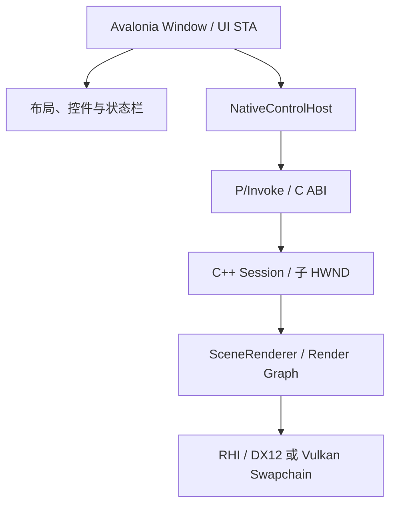

# Avalonia 原生视口原型

本原型验证 Windows x64 上 Avalonia 12.0.5 / .NET SDK 10.0.401 与 RenderLab 原生运行时的进程内集成。构建、运行和自检入口见 [使用说明](../manual/build.md#avalonia-嵌入原型)。阶段状态与实际验证范围统一见 [M7.1](../design/phaseplan.md#m71-桥接与视口试验)。

## 窗口与渲染的边界

整个编辑器窗口、布局和普通面板由 Avalonia 管理。中央 `RenderViewportHost : NativeControlHost` 向 C++ 请求一个子 HWND，C++ 在这个窗口上创建 Swapchain；图形 API 不经过 C#。原型布局包含管线选择、曝光、暂停、重置相机、重建视口、可拖分隔条和焦点测试文本框。

Avalonia 提供宿主父窗口，Bridge 创建并拥有真正的渲染子 HWND。父窗口可以是 Avalonia 的内部托管窗口，不假定它就是顶层窗口；自检验证渲染 HWND 确实属于顶层窗口的子树。独立 Sandbox/Player 继续使用自己的窗口，不依赖 Avalonia。

普通 Avalonia 控件不能可靠地覆盖子 HWND 的像素区域，即原生窗口的 airspace 限制。视口内 Gizmo、选择框、文字和调试覆盖层应由原生渲染层绘制；本原型尚未接入这些编辑能力。若未来需要任意 Avalonia 控件覆盖视口，应单独验证共享纹理合成及 GPU 同步，再决定是否更换展示方案。

## 调度和销毁

原型把 Create、Configure、Tick、GetStats 和 Destroy 全部放在同一个 Avalonia UI STA 线程。`DispatcherTimer` 以 16 ms 间隔请求一帧；Bridge 不运行另一个消息循环。每个 Session 持有 COM STA 引用，直到原生渲染和展示对象释放后才释放它。

正常帧轮换两个提交完成点，复用对应帧前等待；窗口尺寸从 `GetClientRect` 获取真实像素，而不是把 Avalonia DIP 直接传给 Swapchain。Resize 使用显式 GPU/展示等待，隐藏、最小化、暂停或零尺寸时跳过渲染。恢复后的尺寸变化由现有 SceneRenderer 历史失效逻辑处理。

`CloseViewport` 首先停 Timer，然后等待 GPU/展示，释放 Swapchain 和 SceneRenderer，回收退休资源，记录 Runtime 资源账本，再关闭设备，最后销毁渲染子 HWND。托管宿主必须在父窗口关闭前显式执行它；重复 Close 无操作。没有使用可能在 finalizer 线程调用原生 Destroy 的 SafeHandle。重建视口同样先关闭原生 Session，再移除宿主控件并创建新控件。

UI 线程方案让最小原型容易验证所有权，但首帧 Shader 编译、渲染录制、GPU 等待和 Resize 会阻塞界面。它不是生产编辑器的性能方案。正式工作流需要时，再把渲染运行时迁入单一 owner thread，用批量命令和只读快照沟通；届时必须重新验证窗口线程、输入转发、Resize 与销毁握手。

## C ABI v1

公共 C 头文件为 `src/editor/editor_bridge.h`，托管声明为 `src/editor/managed/NativeMethods.cs`。DLL 与托管程序随同一版本构建，不提供跨版本插件兼容性。

| 契约 | 约定 |
| --- | --- |
| 调用约定 | Windows x64、C 导出、Cdecl；先校验 ABI version 为 1 |
| Session 身份 | uint64 不透明 Handle：低 32 位为槽位加一，高 32 位为 generation；原型最多四个活动 Session |
| 线程 | 父 HWND 属于当前线程；所有 Session API 只允许创建线程调用；后台线程返回 `RL_WRONG_THREAD` |
| 字符串 | 路径为 UTF-8、NUL 结尾，只借用到当前调用返回；内部转换为 Win32 宽字符路径 |
| 内存 | 不跨边界暴露 STL、内部对象指针或 GPU 对象；HWND 只用于托管和输入 |
| 错误 | 成功为 0；C++ 异常在 API 边界转换为状态码，具体错误保存在调用线程的缓冲区 |
| 错误缓冲区 | `required` 包含 NUL；空指针/零容量可以查询大小；容量不足不写入、不截断；先读错误再调用其他 API |
| Stats | 顺序布局、6 个 uint64 加 8 个 uint32，共 80 字节；托管和原生均验证大小 |
| CloseReport | 2 个 uint64 加 2 个 uint32，共 24 字节；记录账本剩余字节、高水位和设备验证错误数 |

创建失败不发布 Handle 或子 HWND；已销毁的 Handle 即使槽位被复用也返回 `RL_INVALID_HANDLE`。Configure 的 pipeline 为 1 Forward、2 Deferred、3 RayTracing，先验证能力再更换选择。窗口点击获得原生焦点，WASD/QE 移动、方向键或右键拖动旋转；失焦清除按键并释放鼠标捕获，捕获被夺走时清除拖动状态。

## 自检与限制

`--smoke` 在实际 Avalonia 事件循环中推进测试，依次验证子窗口关系、当前显示缩放下的客户区像素、非法/过期 Handle、错误缓冲区、后台线程拒绝、Resize、合成输入/焦点/捕获、最小化/恢复、隐藏/显示、三种管线 Present、曝光配置、销毁/重建和最终关闭。输出包含 `smoke.json`、`close-reports.json` 与每个 Session 的日志；失败写 `smoke-failure.txt` 或 `managed-error.txt` 并以非零状态退出。

2026 年 10 月 27 日，Release 双后端自动自检通过。当前显示为 96 DPI；中文日志输出目录通过 UTF-8 C ABI 打开。每后端两次关闭的资源账本均为 0，验证错误均为 0。日志仍有 DX12 optimized clear value 不匹配与 Vulkan 未消费顶点属性警告；不能称为零警告。此处的账本不包含 Avalonia/Skia 或驱动内存，合成输入也不能代替真实鼠标键盘交互验收。

用户按 Esc 停止界面自动化后，没有继续操作窗口；人工可视检查未完成，未对画面质量作验收。跨屏 DPI、非 100% 缩放、Docking/浮动窗口重挂接、覆盖层、长时间运行、多视口同时运行、设备丢失和 Debug 配置也尚未验证。Recreate 是销毁再新建，不代表同一活跃 Swapchain 的跨父窗口重挂接已通过。M7.1 的完整退出条件仍需后续验证。
