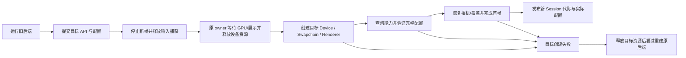
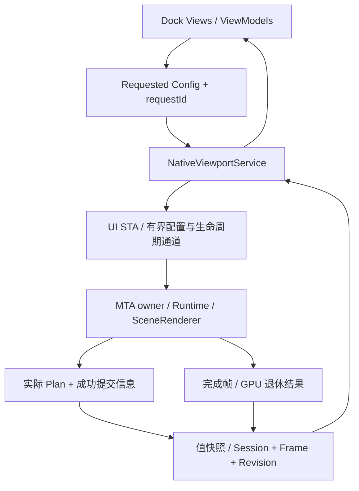

# 固定场景渲染工作台

设计日期：2026 年 10 月 30 日。本文定义本轮 Editor 的目标界面与契约，具体接口是否已接入以 [Editor Host](editor-host.md) 为准。实施任务、状态与实际验收只记录于 [阶段计划](../design/phaseplan.md#m72-固定场景渲染工作台)，不以设计描述代替实现验收。

## 目标与边界

在给定项目与固定场景上，提供 Unity 风格的可停靠渲染实验工作台：观察画面、调整运行配置、查看真实 Render Graph、定位 CPU/GPU 成本。沿用现有 Avalonia、CommunityToolkit.Mvvm、DI 与进程内 C++ Renderer。

- 启动时确定项目/场景；显示场景名称、来源与只读状态。允许导航相机与临时光照覆盖，不增删对象、不修改 Transform/材质/资源引用、不切换或编辑场景文件。
- 配置属于本次运行的覆盖层。Reset 恢复载入值；可保存本机工作台预设，不写回 Scene、Material 或 ProjectSettings。Library/Shader 缓存仍可正常生成，不把缓存写入误判为资产修改。
- Dock 包括 Scene、Render Settings、Render Graph、Profiler、Log；默认只显示 Scene 与 Render Settings，其余从顶部 Window 菜单按需打开。没有占位 Hierarchy、Project 或材质 Inspector。
- 单个活动原生视口与一套 Runtime；普通面板可浮动。Scene 浮动通过销毁/重建宿主实现，不承诺活跃 Swapchain 原地跨父窗口迁移。
- 每个子阶段完成验证后独立提交。设计文件更新不计作实现完成。

## 参考与依赖选择

交互参考 Unity 的 Scene、Inspector、Rendering Debugger、Render Graph Viewer 与 Profiler，保持紧凑工具栏、可折叠属性组、可恢复布局和按帧检查的工作方式。Render Graph 是执行结果查看器，不是可连线改写管线的编辑器。

已只读核对 [Gal.Net dev](https://github.com/StarryXYJ/Gal.Net/tree/dev)，参考快照为 `774b35f7561708a785f5fa1109efebe3b9aa5da5`：

| 参考位置 | 可借鉴内容 | RenderLab 取舍 |
| --- | --- | --- |
| `Dock/EditorDockFactory.cs` | 集中创建默认布局、关联稳定面板 ID | 使用具体 WorkbenchDockFactory，直接装配固定面板 |
| `Dock/DockViewLocator.cs` | Dock 内容与 View 映射 | 固定 DataTemplate/类型映射，不使用反射扫描 |
| `Dock/DockLayoutSerializer.cs` | 版本化布局数据、浮动窗口位置 | 只保存允许的 Dock 节点、面板 ID、尺寸与布局版本，不序列化服务/运行时对象 |
| `Dock/UrsaDockHostWindow.cs`、`App.axaml` | 浮动窗口主题与 Dock 行为分离 | 保留 Dock HostWindow 行为，主窗口与浮窗风格一致 |
| `Directory.Packages.props` | Avalonia 12.0.5、Dock 12.0.0.2、Ursa 2.1.0 | 作为兼容性候选，必须在本项目恢复/构建/原生宿主集成验证后锁定 |

首选 `Dock.Avalonia`、`Dock.Model.Mvvm` 及对应 Fluent 主题，继续使用现有 Fluent 基础。Ursa 按复杂数值编辑/属性布局的实际需要引入；若采用 Semi/Ursa 主题则整体统一，避免叠加两套全局控件主题。本轮不复制参考项目的扩展注册框架、项目工作流或复杂 Inspector 系统。若实施时直接复用 MIT 源码，保留其许可与版权声明；本次只参考结构。

托管日志采用 Serilog，通过 `Serilog.Extensions.Logging` 接入 DI 中的 `ILogger<T>`，使用 File sink 保存结构化滚动日志，并增加有界内存 sink 供 Log Dock 展示。具体依赖版本在 M7.2a 恢复/构建时固定到锁文件，不在设计中假定未核对的版本已经兼容。

## 默认布局与交互

建议初始窗口 1440×900 DIP，最小 1000×680 DIP；尺寸不足时由 Dock 标签组和滚动属性面板容纳内容。默认布局主区约 74%、右侧设置约 26%，Scene 占满主区高度，没有预留的空白底部 Dock。

```text
┌─────────────────────────────────────────────────────────────────────┐
│ RenderLab  Window ▼  Layout ▼   固定场景名称  运行/暂停  单帧         │
├─────────────────────────────────────────────┬───────────────────────┤
│ Scene                                       │ Render Settings       │
│ 最终画面/已有调试视图  尺寸  渲染状态        │ 设备与图形 API        │
│                                             │ 管线/提交/执行        │
│             原生渲染视口                    │ 阴影/反射/曝光        │
│                                             │ 相机/照明临时覆盖     │
│                                             │ 请求值 → 实际生效值   │
│                                             │ 配置状态与失败原因    │
├─────────────────────────────────────────────┴───────────────────────┤
│ DX12 · Deferred · Direct    Ready/Idle/Paused   验证消息 · 源帧号     │
└─────────────────────────────────────────────────────────────────────┘
```

支持拖动停靠、标签合并、拆分、面板最大化、浮动和关闭恢复。顶部 Window 菜单列出 Scene、Render Settings、Render Graph、Profiler、Log，显示打开状态；已打开时激活/定位原面板，隐藏时重新显示，同一面板 ID 不重复创建多个实例。Render Graph、Profiler、Log 首次打开默认停靠在 Scene 下方的标签区，不挤占右侧设置面板；可自行拆分并列或浮动。

Layout 菜单提供 Default（只显示 Scene/Render Settings）、Diagnostics（同时打开 Graph、Profiler、Log，Graph 与 Profiler 可并列）与恢复上次布局。首次启动、重置默认或布局损坏恢复都采用两面板布局；正常重启恢复用户最后保存的面板可见性、位置和比例。布局与设置保存到项目 `UserSettings/Editor/`，写入失败时保留内存配置并报告；不改变项目源数据。

面板关闭不等同于暂停场景。Graph 关闭后停止该面板的快照订阅/自动刷新，Profiler 关闭后停止图表发布；显式采样请求或已开启的 Profiling 配置按其独立状态继续，关闭 Dock 不静默修改渲染设置。Log 关闭后停止列表更新，后台日志记录与有界缓存继续，重新打开可查看缓存内的既有消息。

Scene 的工具栏、浮动标题和状态信息位于原生像素区域外。子 HWND 存在 airspace 限制，Dock 拖放提示与菜单不能假设能覆盖它。Scene 拖移、Dock 全局拖放提示可能覆盖视口时，暂停并隐藏原生子窗口，完成或取消后恢复；若布局导致 NativeControlHost 分离/换父窗口，则先停渲染并退休 GPU，再销毁/重建 Session。禁止直接给活动交换链做 SetParent。普通面板拖动不需要重建设备，但可能需要临时隐藏视口。

布局保存不包含 HWND、Session Handle、GPU 资源、性能历史或设备能力快照。未知面板 ID 被跳过；版本不支持、损坏 JSON 或无可用主区时恢复默认布局并记录原因。浮窗坐标按当前显示器工作区校正，处理显示器移除与 DPI 变化；不恢复到屏幕外。

## Scene Dock

- 保持现有 WASD/QE、方向键与右键视角操作，文本编辑获得焦点时不驱动相机；失焦、隐藏或拖动 Dock 时释放捕获和按键。
- 运行、暂停、单帧、重置相机；暂停时单帧请求只推进一帧，完成后回到暂停。暂停期间的设置变更排队并标记等待，不偷偷恢复连续渲染。
- 区分 Active、Idle、Paused、Resizing、Switching、Failed。静态按需重绘继续生效；性能采样模式显式打开连续刷新。
- 首轮使用 Dock 可用客户区的真实像素尺寸，不默认另分配一张全分辨率离屏图。显示实际宽高和 DPI；固定离屏分辨率/渲染缩放留待独立实现，不提供无效控件。
- 复用已有 Final、HDR、Shadow、Environment、BRDF 和 Reflection 调试视图；逐项检查管线适用性。任意 Pass 的 RT 像素预览不属于首轮必需项。

## Render Settings Dock

面板呈现强类型配置及能力说明，不读取/猜测私有 Shader 变量。所有控件显示请求中、已应用、被拒绝三种结果；失败后不能继续把请求值显示成实际值。

| 分组 | 本轮配置 | 生效边界 |
| --- | --- | --- |
| Device | DX12/Vulkan、当前 Adapter/驱动/能力只读、Validation | API/Validation 变化需要完整视口设备重建；本轮不做 Adapter 任意切换 |
| Pipeline | Forward、Deferred、RayTracing | 已有组合检查兼容性后在帧边界应用，不重建设备 |
| Submission | Direct、IndexedDirect、CpuIndirect、GpuCulled | 按硬件、材质与当前组合检查，沿用 M6 容量限制 |
| Execution | 录制线程 1–16、Async Compute、Memory Alias | 用现有 Graph 编译选项；异步仅支持既有 Buffer feeder 范围 |
| Lighting | 单方向光方向/颜色/强度、环境强度/旋转 | 原生运行配置覆盖；重置后恢复固定场景值，不写回 Scene |
| Shadow | 开关、深度/法线 Bias、分辨率 128–2048 的合法幂次 | 引用既有阴影实现；分辨率变化触发相关资源/历史处理 |
| Reflections | 反射、累积、空间降噪、时间重投影开关 | 受管线能力约束；沿用 Renderer 的历史失效规则 |
| Camera/Display | 导航速度、曝光、重置相机、已有调试视图 | 相机/显示覆盖；曝光不无条件清空不受其影响的 HDR 历史 |
| Scheduling | 目标帧率 0–240、按需/连续刷新、Profiling | 0 沿用无 CPU 限速且关闭强制 VSync 语义，可能需要重建 Swapchain |

上述管线/提交/执行、光照/阴影/反射/曝光/调度与已有调试视图已通过 M7.2b 的 v6 配置桥接接入，具体布局与生效语义见 [宿主契约](editor-host.md#c-abi-v6运行配置与诊断)。API/Validation 创建参数的动态变更仍待 M7.2c；当前显示实际后端与验证状态。光照覆盖在 Renderer 提取后的值快照上应用，不让 C# 持有 Scene Document。

枚举和开关在校验后立即排队；滑动数值以有界最新值邮箱合并，不为每次鼠标消息做一次 GPU 等待。Device 组使用明确的 Apply 操作，合并 API/Validation 的重建请求。原生回报 `requestId`、`requestedRevision`、`appliedRevision` 与失败字段；成功提交首帧前保持 Applying。被更新请求替代的配置标记 Superseded，不伪装成功。

不支持项保留禁用原因，例如 Count/SM 6.8、材质角色、异步队列能力或容量限制；由原生 Runtime/Renderer 验证决定，不在 C# 复制一套能力判定规则。切换到新设备后重新查询能力，不沿用旧后端结果。配置预设载入也走同一验证通道。

## 图形 API 动态切换

可以支持编辑器运行中 DX12 ↔ Vulkan 切换。它的语义是保持编辑器进程和工作台状态，重建原生视口；不是给现有 Device 更换后端。现有服务从只读启动选项选择 Backend，尚无运行时切换入口。



- UI 保持布局、配置副本、相机导航状态与源场景路径；清空旧输入增量。GPU 表、PSO、描述符、BLAS/TLAS、历史纹理和帧完成点全部重建，不能跨 API 迁移。
- 首轮串行销毁再创建，避免两个完整设备场景并存的显存峰值。新后端不支持请求组合时明确失败并尝试恢复旧配置，不悄悄改成另一条管线。
- 回滚也要重新创建旧设备，不承诺一定成功；若回滚失败，工作台进入 Failed，Log 保留两个错误，提供 Retry，禁止无限自动重试。计划内切换不等同于设备丢失恢复。
- 设备资源的创建/销毁继续在专用 MTA owner，HWND 在 UI STA；新增 Stop/Retired 完成通知，让正常重建等待异步进行，不在 UI 调用中长时间阻塞 GPU。HWND 卸载可按既有受限 Win32 握手收尾，不能从任意后台线程调用旧 Destroy。
- 每次重建递增 Session 代际，丢弃旧回调、GPU 计时与 Graph 结果，保留带后端标签的历史导出但不连接不同后端的活动曲线。布局恢复不自动触发多个重复 Session。
- 编译/上传期间显示 Switching 与实际阶段，不承诺无停顿。保持当前单活动视口，重建后确认首帧成功再显示 Ready；未确认前没有虚假的活动 FPS。
- 切换前已暂停时，新后端只执行验证所需的初始化帧，然后保留 Paused，不自动恢复连续运行。最小化/隐藏或零尺寸时暂停首帧展示确认，保持等待有效尺寸的状态，恢复后再完成确认；不为了切换在不可展示窗口上强制 Present。

## Render Graph Dock

默认以 **Pass × Resource 访问矩阵** 检查，附带选中项的依赖图与生命周期视图，交互参考 Unity Render Graph Viewer。首屏显示存活 Pass 的实际执行顺序；可展开查看被剔除 Pass 及原因。

- Pass：名称、快照内 ID、Raster/Compute/Copy/RayTracing 类型、Graphics/Compute 实际队列、顺序、录制块、源位置、剔除原因及有来源帧的 GPU 耗时。
- Resource：名称、Texture/Buffer 类别、格式/尺寸/Buffer 字节数、import/export、版本、首末使用、逻辑估算字节、Alias 组。物理分配与逻辑资源大小分开显示。
- Access：Read、Write、ReadWrite、Color/Depth、Storage、Indirect、Copy 等用途，输入/输出版本及范围。选中单元格列出生产者与消费者，不只显示同名 RT。
- Dependency：实际 Plan 的 RAW/WAR/WAW/显式顺序原因和队列等待；资源内容依赖、顺序依赖与 Alias 内存复用采用不同线型/标签。Alias 共用内存不代表共享逻辑内容。
- 支持搜索 Pass/Resource、定位上下游、缩放/平移、Freeze/Live、手动刷新和导出快照。Freeze 只冻结观察帧；不暂停渲染。真正暂停或单帧由 Scene 工具栏控制。

数据以 `Graph::GetPlan()` / `Plan::ToJson()` 的编译结果为权威。现有结构已提供 accesses、版本、edges、schedule、barriers、aliasGroups 和生命周期；类型/格式/尺寸、export、完整范围、录制块与可关联的 Pass ID 需要补入诊断快照，不能声称现有 JSON 已完整提供。

只在图成功提交后发布常规快照，标记 Session、配置版本、帧号、拓扑版本与执行状态。编译或提交失败可发布独立 Failed 诊断，不能替换为“本帧已执行”。拓扑数据按签名变化更新，Live 至多每 500 ms 复制一次最新拓扑；Freeze 可钉住一个有界快照，不保活整个 Graph 或 GPU 对象。GPU Timing 单独带源帧关联，尚未完成显示 Pending，不把旧帧耗时贴到新拓扑。

**默认只观察元数据，不为查看面板插入读回或改变图根。**旧版本 handle 不保存旧图像，Alias 可能已覆盖内容。后续若加入选定 RT 像素检查，必须在指定版本最后有效处插入显式 Copy/转换并按完成点读回，标记诊断模式和增加的 Pass/内存成本；不为所有 Pass 持续复制 RT。

## Profiler Dock

从 Window 菜单打开后，概览显示帧时间曲线、CPU 分段与绘制统计；选中完成帧后联动 Graph 的相同源帧/拓扑。提供 Live、Freeze、采样清空、连续采样模式与导出。所有未知、未开启、超出计时上限或尚未完成的数值显示 N/A/Pending，而不是 0。

| 指标 | 定义与来源 |
| --- | --- |
| FPS、帧间隔 P50/P95/P99 | 成功 Present 调用完成间隔的窗口统计，来自原生完成帧队列；展示样本数与丢样数。Idle/Paused 不沿用旧 FPS，也不把 Present 返回当作扫描输出 |
| CPU Frame | 渲染线程本次帧工作的 wall time，分别显示场景准备、建图/编译、准备、录制、提交、Fence/Acquire/Present 等；嵌套区间不能重复相加，调度等待单列 |
| GPU Pass / GPU span | 真实完成后读取 Timestamp，带源帧号；Pass 总和、每队列时间与有共同时间域的最早开始到最晚结束跨度分别标注，多队列 Pass 总和不等于帧延迟 |
| 提交→GPU 完成延迟 | 使用该帧真实完成点非阻塞轮询，记录 CPU 观测到完成的时间差，包含队列等待与轮询分辨率；不是精准 GPU 执行时长或输入到屏幕延迟 |
| Direct draw API calls | 原生录制实际发出的 Draw/DrawIndexed 调用数，按 Pass/不透明/阴影/透明/全屏分项；不能简单统计 DrawPacket 数 |
| Indirect API calls | ExecuteIndirect / DrawIndirect[Count] 调用数；一次调用可执行多条绘制命令，单独显示提交的最大命令容量 |
| Batches | 按管线/绑定/渲染状态形成的几何提交批次数，明确所属 Pass 与统计范围，不把 CommandList chunk 或队列 Submit 次数叫作 batch |
| Instances | 几何候选实例数、CPU 已知可见数、实际提交实例数分别展示。GPU Count/可见数默认未知；显式开启诊断读回后显示延迟结果及源帧，不能用容量当实际数量 |
| Dispatch / TraceRays | Compute 调用、光追派发与尺寸独立统计，不折算为 draw call；AS 构建/更新按独立项显示 |
| Memory / Upload | RHI tracked native 当前/峰值、Graph Pool/Alias、上传字节/页、描述符占用。估算字节、实际分配和驱动驻留显存分开，未采集的驱动数据标记不可用 |

统计在 Renderer 或实际命令发射处产生，并附 Pass/类别标签。并行录制用每块局部计数，成功录制/提交后合并，取消和失败不会冒充已提交帧；不增加每 Draw 共享锁。CPU 记录的 API 调用数不依赖 GPU 可见数量读回。

当前桥接已有部分 CPU 分段、GPU Pass 总和、帧间隔和 native 内存；Draw/Indirect/Batch/Instances、每 Pass 数据、GPU span 与完成延迟需要补充。现有 GPU profiling 单图最多 32 个 Pass；工作台应在请求计时前检查预算，超出时关闭该图的 GPU timing 并说明原因，保留画面与基础计数。此降级也是待实现行为，不能假定现有 Graph 已支持任意数量的部分计时。扩展计时预算需要独立测量，不能为面板无条件提高预算或强制同步。

数据分层：基础整数计数；可选 CPU/GPU timing；显式 GPU 可见性读回。关闭 timing 时保留低成本计数，关闭读回时不创建 Count 诊断资源。基准导出记录所有诊断开关、分辨率、后端、管线、提交方式与场景标识，方便与独立 Player 对照。

## Serilog 与 Log Dock

Log 是默认隐藏、可从 `Window > Log` 打开的工具面板。状态栏持续显示本次运行的 Warning/Error 数，点击可打开 Log 并定位相应级别；新错误不会自动弹出或抢走 Scene 焦点。配置失败仍在设置面板保留就地说明，完整异常和上下文进入日志。

面板使用虚拟化列表，显示时间、级别、来源、消息；支持按级别/来源筛选、文本搜索、自动滚动开关、清空当前列表、复制和打开日志目录。选中项展开异常堆栈与结构化属性。清空列表不删除磁盘日志、不重置真实 GPU 验证计数；关闭面板不关闭日志系统。

托管层在应用启动早期创建 Serilog，DI 服务通过 `ILogger<T>` 记录结构化消息；进程退出在所有原生 Session 关闭、末尾日志取完后刷新并释放 logger。正常路径写配置接受/应用/拒绝、Session 创建/销毁、API 切换/回滚、Dock 生命周期与可恢复错误；默认 Info，诊断时才启用 Debug/Verbose。不将逐帧性能样本或每条 Draw 写成文本日志，Profiler 仍走原有数值采样通道。

事件字段至少包括 UTC 时间、Level、SourceContext、MessageTemplate/渲染消息和 Exception（若有）；可关联时附 EditorRunId、SessionGeneration、Backend、RequestId/ConfigRevision、FrameId、NativeSequence。界面可按本机时区显示时间，磁盘保留 UTC。File sink 输出滚动结构化日志到已配置输出目录的 `logs/`，初始按天/单文件 16 MiB 滚动、保留最多 10 个文件；打开面板不会创建另一份重复的应用日志。

原生 C++ 保留独立 Logger 与现有逐 Session 日志，Sandbox/Player 不依赖 Serilog。为 Editor 添加可选有界日志镜像队列，通过 UI 侧 C ABI 批量取出 UTF-8 值事件，再送入托管 Serilog；禁止原生渲染/驱动验证回调直接调用 C# sink 或 Dispatcher。容量不足时返回所需空间而不消费消息，按 Session/NativeSequence 避免重试导致重复。原生日志进面板时使用原事件的时间、级别、来源与序号，不能重新盖成拉取时间；汇入后的应用日志带 `Origin=Native`，保留原生日志文件用于完整诊断，不再同时 tail 文件重复采集。设备关闭后的末尾事件仍按原 Session 展示，不套用新后端标签。

日志镜像/内存 sink 必须有界且异常隔离：原生队列和托管待发布队列初始各最多 4096 条且各最多 8 MiB，Log 可见缓存最多 10000 条且合计最多 8 MiB。面板事件单条最多 16 KiB，超长消息标记截断并指向原始文件；原始日志不因面板限制而截断。超限按明确规则丢弃较早的镜像事件并累计 dropped 数，通过独立状态显示，不能递归写入同一个已满 sink。默认每 250 ms 有界批量发布到 UI，不逐事件触发 Dispatcher；面板隐藏时缓存仍按预算轮转。

日志系统自身的写入/序列化/sink 异常走隔离的 stderr/备用错误文件与可见状态，不再次进入同一 Serilog 管线，不能让 Log 面板故障终止 GPU 录制。关闭时 drain 原生末尾日志并报告未排空/丢弃计数，不能声称有界内存队列保证零丢失。托管未处理异常尽力写 Fatal/flush，但不把不可恢复异常吞掉或声称所有原生崩溃均可捕获。

## 数据、线程与桥接



保持单个托管应用项目。增加具体 Workbench ViewModel、DockFactory 与 RenderSettings/RenderGraph/Profiler/Log ViewModel；将图表或图绘制封装为控件。Dock Document 的 Context 保存稳定面板身份与 View 工厂，每个 presenter 新建控件，服务和模型共享；布局仅保存白名单值，不序列化控件、工厂或服务。Serilog 的文件/内存 sinks 在应用入口装配，Log ViewModel 只展示有界事件投影。NativeViewportService 继续负责 Session 生命周期，具体快照模型与统计窗口可分文件，不引入插件总线或另一份 GPU Scene。

配置桥接已随同 DLL/托管程序集升至 v6，不兼容旧布局时启动明确拒绝；Stats 为 256 字节，Config/ConfigState 为带 size/version 的 112/272 字节定宽 POD。能力说明使用 schemaVersion=1 的 UTF-8 JSON。后续可变 Graph 快照/导出也使用有版本的 UTF-8 JSON，不能每帧把完整图序列化并跨边界。

可变快照采用 AcquireLatest/Copy/Release 的不透明快照 ID，先钉住不可变 CPU 值数据，再查询长度并复制，防止两次调用之间图已更换；不跨 ABI 暴露 STL、指针或资源引用。每 Session 最多保留 latest 与一个 pinned 快照，单份初始上限 4 MiB；超限明确报告，不返回截断的半张图。完成帧队列沿用有界 512 项，UI 曲线最多保留 240 个活动样本，展示统计窗口时长/数量；基础 UI 250 ms 发布，关闭面板停止对应视图更新。

所有快照携带 `(sessionGeneration, frameId, configRevision, topologyRevision)`；设备切换、源帧失配或配置变化时拒绝错误关联。帧统计与 GPU 计时允许晚到，但必须保留源帧；同名 Pass 不作为唯一跨图身份。没有数据时保留“最近完成帧”的明确标记。

## 验收依据

具体执行任务与状态以阶段计划为准，以下是行为标准：

| 范围 | 必须证明的行为 |
| --- | --- |
| Dock/原生宿主 | 首次/默认布局只显示 Scene 与 Render Settings；其余三个面板从顶部菜单打开且不重复创建，关闭无空白占位，重启恢复布局，诊断布局可一键打开；所有面板可停靠/浮动，Scene 拖出/停回、取消拖放、主窗最小化恢复、跨屏 100%/150% DPI 下无黑屏、输入残留或失效 HWND |
| 固定数据 | 操作配置与保存预设前后 Scene/Material/ProjectSettings 源文件 hash 一致；重新载入可恢复给定场景，缓存变化单独排除 |
| 配置 | 双后端 Forward/Deferred/RayTracing 及支持的提交/线程/队列/Alias 组合生效可见；非法配置保留实际值并解释拒绝原因；快速拖动/多次请求只应用一致版本 |
| API 切换 | DX12→Vulkan→DX12 至少 10 轮，含暂停、最小化、恢复、Dock 迁移；相机/覆盖/布局保留，历史按规则重置，旧设备关闭账本为 0；目标失败和回滚失败均有确定状态 |
| Graph | 已知小图对比 Plan 的 Pass/版本/读写/边/队列/Alias；Forward/Deferred/光追/GPU 剔除切换产生相符拓扑；Freeze、剔除项、失败图与源帧晚到均不串帧；仅打开 Viewer 不增添渲染 Pass 或读回 |
| Profiler | 已知 direct/indirect/多实例/透明/阴影/全屏/Compute/TraceRays 工作量核对计数；GPU 未读回时显示未知；Idle/Pause 不显示假 FPS，多队列重叠不重复算成帧延迟 |
| Log | 托管异常与原生验证消息的级别/来源/时间正确，批量拉取不重复，API 切换保留旧 Session 标签；筛选/暂停滚动/清空/重开可用；消息洪峰、超长消息、滚动文件、sink 失败与关闭 drain 都有确定行为，GPU 验证错误数不因 UI 操作清零 |
| 持续运行 | 双后端分别至少 30 分钟交互/连续采样，记录内存高水位、快照和队列有界性、丢样数、验证错误、关闭账本；不把未运行的硬件/DPI/设备丢失用例记作通过 |
| 观察成本 | 相同场景/尺寸/配置下对照面板关闭、基础计数、Timing、GPU 可见性读回四档，记录 CPU/GPU/内存差异；没有测量不宣称面板零开销 |

设备丢失恢复、任意 RT 历史像素回放、多视口、资源/场景编辑、通用 Undo 和跨平台窗口托管不属于本轮出口。长期完整编辑器目标继续保留在 M7 后续计划中。
