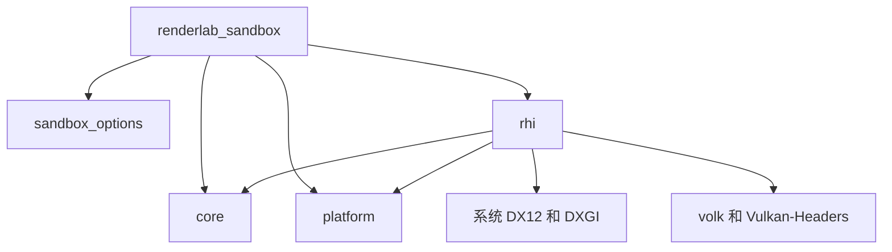

# M0 基础模块

M0 建立了可独立运行的 Windows 原生 Sandbox、日志与诊断、双后端设备初始化，以及机器可读的能力报告。模块保持具体和精简，为 M1 添加资源、交换链和提交同步提供入口。

本文保留 M0 的模块说明和当时的验收边界；新增提交、展示与资源 API 见 [M1 最小 RHI](m1-rhi.md)，当前状态以 [阶段计划](../design/phaseplan.md) 为准。

## 目标与依赖

`renderlab_options` 为自有 Target 提供 C++20、Unicode、UTF-8 和警告规则。core 提供 Logger 和 Debug 断言，platform 提供 UTF-8/UTF-16 转换与 Win32 Window，rhi 提供 Device、查询结果及 JSON 序列化。参数解析属于 Sandbox，不放入通用引擎核心。

## 窗口与关闭

Window 拥有 HWND，禁止复制，销毁时释放原生窗口。NativeSurface 只提供非拥有的窗口和实例指针。窗口状态记录客户区尺寸、最小化状态及关闭请求；WM_CLOSE 先发出请求，避免消息回调在设备仍活跃时销毁 HWND。

程序先创建 Logger，再创建 Window 和 Device。退出时先关闭并释放 Device，再销毁 Window，最后释放 Logger；初始化失败也遵循 RAII 清理。Vulkan 的 Shutdown 幂等，按 Device、Debug Messenger、Instance、Loader 顺序清理。报告在设备清理后读取验证错误计数，包含设备清理期间的 Vulkan 回调。

消息循环使用消息等待而非忙轮询。M0 没有渲染帧，`--exit-after-ms` 是宿主生命周期测试参数，不代表 GPU 帧数。窗口自动测试检查实际客户区缩放、最小化与恢复事件，最后通过正常 WM_CLOSE 请求退出。

## 设备与能力

CreateDevice 是后端选择入口。默认跳过软件适配器，按后端的高性能偏好选择可初始化硬件；显式索引允许选择报告中的特定设备，错误索引返回清晰诊断。

DX12 要求 feature level 12_0 和 Shader Model 6.0，创建一个 Direct Queue，查询 Shader Model、Resource Binding Tier、DXR Tier、Mesh Shader 及基础格式能力。当前 SDK 探测 Shader Model 到 6.8，报告表示已确认支持的版本，不推测超出探测范围的最高能力。

Vulkan 要求 Loader 和物理设备支持 1.3，验证 Dynamic Rendering、Synchronization2、Timeline Semaphore、Swapchain 扩展，以及兼容 Graphics/Compute 和 Win32 Presentation 的队列族。只创建一个队列并启用上述基础功能，光追和描述符索引等高级能力仅查询。

FormatSupport 验证 RGBA8_UNORM、RGBA16_FLOAT 可采样并作颜色附件，D32_FLOAT 可作深度附件。Storage 等附加能力按 API 查询报告，不据此提前承诺完整格式可移植性。

JSON 报告的 `schemaVersion` 为 1，包含适配器列表、选中索引、API、驱动、Shader 目标、队列、格式、supported、details、warnings 与验证状态。DX12 的队列记录描述创建的 Direct Queue；Vulkan 描述驱动报告的队列族，不能直接比较两者的 count。显存数字来自各 API 的本地内存信息，集成 GPU 可能包含共享内存，不是当前预算或精确可用容量。

## 日志与验证

Logger 通过互斥锁向终端和文件输出 UTC 时间、级别与消息，文件使用二进制模式保持 LF。文件打开或写入失败会传播错误。普通运行错误返回非零退出码，参数错误返回 2；Debug 断言带源位置，进程终止用于暴露程序错误，不代替输入验证。

DX12 接入 Debug Layer 和 InfoQueue，轮询警告与错误。Vulkan 接入 Khronos Validation 和 Debug Utils，回调内不向驱动抛出异常。auto、on、off 的降级策略在启动前确定，严格 GPU 测试始终使用 on。

## 验收记录

验证日期为 2026 年 10 月 23 日。工具版本、执行命令见 [构建与运行](../manual/build.md)。

| 检查 | 结果 |
| --- | --- |
| Debug 构建与 CTest | 9/9 通过，包括严格验证的双后端初始化和窗口生命周期 |
| Release 干净配置与 CTest | 9/9 通过，同样启用严格验证 |
| 头文件依赖 | Ninja 记录 window.hpp、text.hpp；修改 window.hpp 的时间戳会触发其消费者重编译 |
| 无变更增量构建 | 无需执行工作 |
| 指定第二适配器 | DX12/Vulkan 均在 Intel Graphics 成功初始化，验证开启、错误数 0 |
| 无效适配器索引 | 两后端对索引 999 返回运行错误 |
| Unicode 路径 | 实际写入中文目录中的 JSON 报告与日志，编码和 JSON 解析通过 |
| 格式 | 自有 C++ 使用 clang-format 22.1.3 检查 |

主适配器的实测报告如下：

| 项目 | DX12 | Vulkan |
| --- | --- | --- |
| GPU | NVIDIA GeForce RTX 5060 | NVIDIA GeForce RTX 5060 |
| 驱动 | 32.0.15.9174 | NVIDIA 591.74 |
| API/Shader | feature level 12_0 最低要求，确认支持 SM 6.8 | 物理设备 1.4.325，请求 API 1.3 |
| Validation | 开启，错误数 0 | 开启，错误数 0 |
| AS、Ray Query、Ray Pipeline、Mesh Shader | 查询支持 | 查询支持 |

生成的原始报告和日志保存在对应构建目录的 reports、logs，以及 CTest 的 Testing 中，不提交本机产物。

## M1 接入边界

M0 不提交 GPU 工作。M1 添加真实命令后，Shutdown 和资源释放必须依据完成点处理，不可直接销毁在途对象。窗口 resize、最小化和恢复由宿主发出状态，后续展示层负责交换链与相关 GPU 资源。

M0 交付时 RHI 只抽象设备与报告，没有空资源接口。M1 在该入口上加入交换链、FrameContext、资源与完成点；渲染图、材质和编辑器仍按各自阶段实现。
