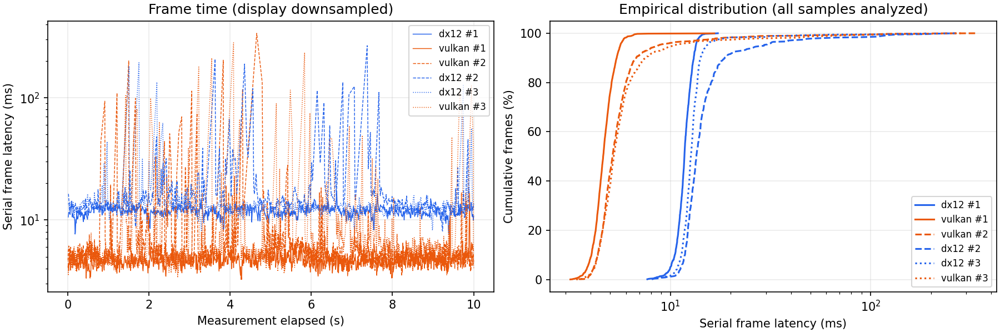
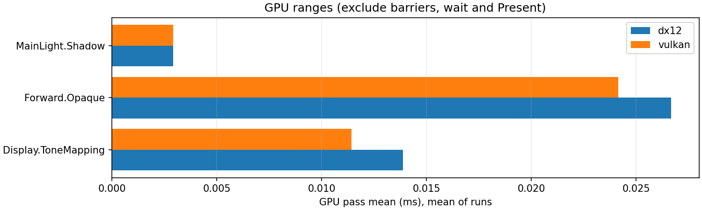

# B1：PBR 双后端 Benchmark 示例

2026 年 10 月 26 日，NVIDIA GeForce RTX 5060、MSVC 19.51、DXC 1.9，Release、validation off、1280×720、Medium、Final。项目为 sample/m4/Pbr.rlproject，固定场景相机，GPU profiling 开启。DX12 驱动报告 32.0.15.9174，Vulkan 报告 NVIDIA 591.74。

使用 [配置](../../sample/benchmark/pbr.json) 运行正式工具，每后端 3 次，每次预热至少 5 帧且至少 2 秒，测量至少 10 秒。顺序为 DX12、Vulkan、Vulkan、DX12、DX12、Vulkan；两后端分别采集 2127、4781 帧，共 6908 个原始帧样本，没有剔除尖峰。

```powershell
python tools/benchmark/run.py sample/benchmark/pbr.json --plots --output out/benchmarks/b1-pbr-release
```

测试可执行文件 SHA-256 为 `01b19104e797f064dc9f29f394a8e3a18262e44bd018243de8ad5dbd283acd57`。清单的工作区 sourceRevision 为 7222aff，trackedChanges=true；该字段记录工作区状态，exe hash 才唯一标识本次二进制。紧凑数值与源内容 hash 保存在 [summary.json](b1-pbr-rtx5060/summary.json)。完整本机原始数据、设备/进程日志、截图及分析输出在 out/benchmarks/b1-pbr-release；这些运行产物不纳入源码。

| 后端 | 每次均值的平均 ms | 每次 P95 的平均 ms | 均值的重复间标准差 ms | CPU render 平均 ms | GPU Pass 合计平均 ms |
| --- | ---: | ---: | ---: | ---: | ---: |
| DX12 | 14.2542 | 19.3053 | 2.7365 | 9.7782 | 0.0435 |
| Vulkan | 6.3030 | 8.1862 | 1.4499 | 2.4514 | 0.0385 |

| 后端/重复 | 样本数 | 帧均值 ms | P50 ms | P95 ms | P99 ms |
| --- | ---: | ---: | ---: | ---: | ---: |
| DX12 / 1 | 840 | 11.7524 | 11.7437 | 13.3870 | 14.2283 |
| Vulkan / 1 | 2060 | 4.6762 | 4.6108 | 5.6033 | 6.4060 |
| Vulkan / 2 | 1426 | 6.7739 | 5.1284 | 8.6818 | 41.0135 |
| DX12 / 2 | 572 | 17.1766 | 13.4767 | 29.3124 | 115.9699 |
| DX12 / 3 | 715 | 13.8335 | 12.6464 | 15.2164 | 39.5913 |
| Vulkan / 3 | 1295 | 7.4590 | 5.2105 | 10.2734 | 63.6835 |

本轮 Vulkan 的串行帧均值比 DX12 低约 55.78%，但重复间波动约为均值的 19%/23%，且存在明显长尾。本轮未控制桌面后台负载、电源和温度，不能将全部差异归因于后端设计。可观察到 CPU render 的差距远大于 GPU Pass 范围差距；确切原因仍需 CPU/驱动与提交路径剖析，这里没有据此作优化结论。

帧时间包含 Render 调用和等待 GPU 完成的时间，没有 Present 或窗口帧重叠；GPU Pass 合计不包括范围间屏障、查询解析等。墙钟 FPS 另外包含逐帧 profile 读取/JSONL 输出开销。各项不能互换，定义见 [计时契约](../benchmark.md)。



图中帧时间轴使用对数刻度以同时展示主体与长尾；显示可以下采样，P50/P95/P99 始终由完整样本计算。



这是一份工具能力与本机行为记录，不替代其他 GPU、其他项目或窗口流水性能验收。可用相同清单独立重做分析，也可扩展 cases/指标，持续保留原始样本。
