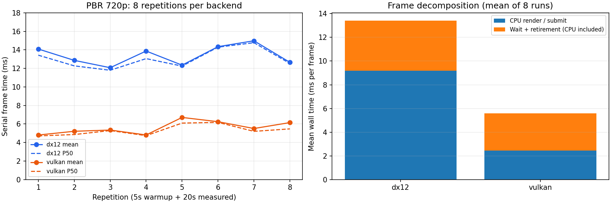
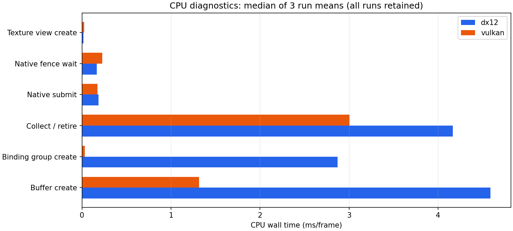

# B2：扩大样本与双后端 CPU 开销定位

结论：差距在扩大样本后仍然复现，主要落在当前实现的 CPU 资源创建、描述符绑定组和资源回收。两边都是 RTX 5060、Release、validation off；GPU 着色范围只差数微秒，不能用“GPU 着色快了两倍”解释完整帧差距。

## 扩展基线

相同 PBR 场景、1280×720/Medium/Final，保留 B1 原二进制，每后端 8 次，每次预热至少 5 秒/5 帧、测量至少 20 秒，交替后端顺序。共 16 次运行，DX12 11,849 帧、Vulkan 27,959 帧，共 39,808 帧。

```powershell
python tools/benchmark/run.py sample/benchmark/pbr.json --seconds 20 --warmup-seconds 5 --repeats 8 --plots
```

| 指标，8 次等权平均 | DX12 | Vulkan |
| --- | ---: | ---: |
| 串行帧时间均值 ms | 13.4026 | 5.6008 |
| 每次 P95 的平均 ms | 15.5827 | 7.1874 |
| 运行均值的重复间标准差 ms | 1.0545 | 0.6977 |
| CPU render 均值 ms | 9.1965 | 2.4398 |
| 提交返回后的 Wait 均值 ms | 4.2061 | 3.1610 |
| Graph compile 均值 ms | 0.0259 | 0.0229 |
| Graph prepare 均值 ms | 0.2359 | 0.0794 |
| Graph record 均值 ms | 3.0226 | 0.1274 |
| GPU Pass 合计均值 ms | 0.0435 | 0.0392 |

8 组配对都出现 DX12 较慢，差距不是前一轮少量尖峰独自造成。CPU render 差约 6.76ms，占完整帧约 7.80ms 差距的 87%。重复间仍有波动，这些数字只描述本机、当前实现和串行 headless 模式；逐帧样本存在相关性，不将近四万帧当作同等数量的独立统计重复。



## RHI 操作探针

增加显式 `--cpu-profile`，默认关闭，不改变分配/执行策略。探针分别计时 Buffer 创建、BindingGroup 创建、TextureView 创建、原生提交、Collect 回收和原生 Fence 等待，并记录调用次数。使用 [诊断配置](../../sample/benchmark/pbr-diagnostics.json)，每个对照各后端 3 次、预热 2 秒/测量 5 秒，共 24 次、20,816 帧。原始和诊断两组合计 40 次、60,624 帧，另有 Debug/Validation 验收。

下表为完整 PBR 720p 的“每次运行均值的中位数”，单位 ms/frame。短诊断出现过长时间停顿，因此用明确标注的中位数展示典型开销，完整的每次均值/分位数均保留，未删除运行或样本：

| CPU 操作 | DX12 | Vulkan |
| --- | ---: | ---: |
| Buffer 创建，23 次/帧 | 4.5881 | 1.3157 |
| BindingGroup 创建，10 次/帧 | 2.8705 | 0.0326 |
| Collect 回收 | 4.1673 | 3.0065 |
| 原生提交 | 0.1868 | 0.1733 |
| 原生 Fence 等待 | 0.1684 | 0.2276 |

当前 gpuWaitMs 包含 Runtime.Wait 内的 Collect。探针证明典型几毫秒的该指标主要是完成后的 CPU 回收，实际 Fence 等待在约 0.2ms。Retire 区间不覆盖所有析构：被图剔除、没有进入提交的资源也会在 Render 返回前释放。这些探针是特定操作的包含驱动/系统工作的墙钟区间，不是完整 CPU 覆盖或线程运行时间。



代码对应关系：

- SceneRenderer 的参数上传和 Material Runtime 准备每帧创建独立常量 Buffer，Graph profiling 另建 timestamp 读回 Buffer。最终 PBR 共 23 次 Buffer 创建；D3D12 CreateBuffer 使用 CreateCommittedResource，而不是现有 UploadArena 的片段。
- DX12 每个 BindingGroup 各创建资源/采样器 shader-visible DescriptorHeap。PBR 的 9 个材质绘制加 Display 为 10 个组，对应 19 个 shader-visible heap；随后完成点回收又释放这些对象。
- Vulkan 同样有临时 Buffer/DescriptorPool 的生命周期开销，但此驱动上的绑定组创建成本小得多。资源回收也明显耗时，因此两后端都有优化空间。

实现入口为 src/renderer/scene_renderer.cpp、src/material/runtime.cpp、src/rhi/dx12/dx12_resources.cpp、src/rhi/dx12/dx12_pipeline.cpp、src/rhi/runtime.cpp。没有把时间归因到某个无法观察的内核函数；探针定位的是这些已测量的操作区间。

## 对照结果

同样采用“3 次运行均值的中位数”；对照场景本身改变了画面或 Draw 数量，属于定位实验，不是相同画面的后端性能基线。

| 对照 | Buffer/帧 | BindingGroup/帧 | DX12 帧 ms | Vulkan 帧 ms |
| --- | ---: | ---: | ---: | ---: |
| 完整 PBR 1280×720 | 23 | 10 | 13.3141 | 5.8459 |
| 完整 PBR 257×193 | 23 | 10 | 12.8018 | 5.4246 |
| PBR 的 BRDF 查看 | 23 | 1 | 8.0815 | 4.1639 |
| 原始较小 RenderLab 场景 | 11 | 4 | 4.7897 | 2.2260 |

降低像素数保留相同创建次数，CPU 差距仍在。BRDF 查看保留场景参数/材质准备，但剔除无消费者的 Forward 绘制，绑定组变为 1 个；DX12 绑定组创建由约 2.87ms 降到 0.018ms。对象较少的场景也降低创建/回收成本。这些实测和调用计数共同指向逐帧资源生命周期，而非 PBR 数学函数。

短诊断 PBR 720p 的第三次 Vulkan 运行只有 22 帧、均值 223.895ms、单帧最大约 703ms，停顿主要落在回收区间；低分辨率第一轮 DX12 也出现较大波动。未通过关闭其他进程或修改系统电源设置消除这些因素，无法仅凭墙钟探针确定停顿的驱动/系统根因。全量均值和长尾保留在原始报告，正式后端比较以前述更长的 8 次基线为主。

## 证据与后续方向

原始组：out/benchmarks/b2-pbr-extended；诊断组：out/benchmarks/b2-cpu-diagnostics。两组各有完整 manifest、逐帧 JSONL、设备报告、截图与分析图表；本仓库保存 [紧凑数值与所有逐次统计](b2-pbr-rtx5060/summary.json)。

原基线 exe SHA-256：`01b19104e797f064dc9f29f394a8e3a18262e44bd018243de8ad5dbd283acd57`。探针 exe SHA-256：`def06eda6ef2fd733060cd61766c7994eda1d35eac8a416e8cbe05d5e3a5f6be`。诊断增加计时开销并使用另一二进制，不混入原基线作为性能优化结果。

优化优先级是：为帧/对象常量使用完成点保护的上传区、复用未修改材质的不可变数据、按完成点复用描述符空间及 profiling 读回资源，减少原生创建/销毁。长期 Material 快照仍需保持不可变，不能简单用每两帧覆盖的内存替换所有常量 Buffer。本轮完成扩大样本与定位，分配策略改动应单独验证前后画面、在途生命周期和性能。
