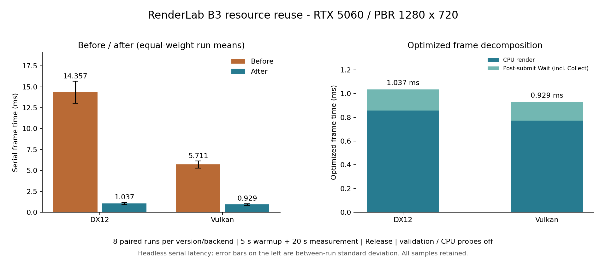

# B3：资源复用优化结果

设备及配置沿用 [B2](b2-pbr-rtx5060.md)：RTX 5060、Release、validation off、PBR 1280×720/Medium/Final，串行 headless。各子阶段保留独立原始结果和可执行文件，不改变测量口径。

## 最终配对长基线

优化前后分别在两后端运行八次，每次至少 5 秒预热/5 帧、20 秒测量；每轮反转版本顺序和后端顺序，全部顺序执行，不与构建或其他 GPU 验收并发。共 32 次、360,600 帧：原版 DX12/Vulkan 为 11,083/27,171 帧，优化版为 153,112/169,234 帧。驱动为 32.0.15.9174，CPU profiler 关闭，所有运行 Validation 错误数为 0。

以下均值和分位数分别对八次运行等权平均；标准差表示八次帧均值的离散度，不把数十万相关帧视为独立重复：

| 指标，ms | 原版 DX12 | 优化 DX12 | 原版 Vulkan | 优化 Vulkan |
| --- | ---: | ---: | ---: | ---: |
| 串行帧均值 | 14.3575 | 1.0365 | 5.7114 | 0.9293 |
| P50 的平均 | 14.0256 | 0.9645 | 5.4888 | 0.8808 |
| P95 的平均 | 17.0373 | 1.4641 | 7.0984 | 1.2594 |
| P99 的平均 | 21.1298 | 2.5911 | 9.6365 | 1.8641 |
| 重复间帧均值标准差 | 1.3114 | 0.1420 | 0.4306 | 0.0936 |
| CPU render | 9.7019 | 0.8569 | 2.3772 | 0.7726 |
| 提交后的 Wait，含 Collect | 4.6556 | 0.1796 | 3.3342 | 0.1568 |
| GPU Pass 合计 | 0.0424 | 0.0343 | 0.0383 | 0.0317 |

DX12 串行帧均值降低 92.78%，Vulkan 降低 83.73%。八组配对两后端全部复现收益，单组耗时比为 DX12 11.00–16.52、Vulkan 5.13–6.96。后端均值比由约 2.51 降为约 1.12，剩余均值差约 0.107ms；这不构成某 API 固有优劣的结论。GPU Pass 合计仍不含完整屏障/读回等范围，收益主要来自 CPU 资源生命周期。串行延迟不等同于窗口流水吞吐或 Present FPS。

32 张截图分别与同后端 B2 的对应 BMP 全文件逐字节相同；Shader 和项目资产 hash 在两版本及所有运行中一致。没有降低画质或删去渲染阶段。原始和优化版都保留相同每帧 GPU Wait；采样/导出仍位于 frameTimeMs 计时外，完整循环吞吐另见原始报告。

未删除尖峰：原版 DX12/Vulkan 单帧最大为 128.38/532.17ms，优化版为 45.02/230.19ms。优化降低了常规创建/销毁成本，不能据此声称消除了驱动或系统调度停顿。完整逐次分布、所有运行和峰值均保留在 [数值摘要](b3-resource-reuse/summary.json)。

## 分配与占用验证

独立 CPU 探针与长基线分开运行；稳定完整 PBR 预热后：

| 每帧操作 | 优化前 | 优化后 |
| --- | ---: | ---: |
| Buffer 构造，两后端 | 23 | 0 |
| 默认 View 构造，两后端 | 12 | 0 |
| DX12 shader-visible heap 创建 | 19 | 0 |
| Vulkan DescriptorPool 创建 | 10 | 0 |
| 逻辑 BindingGroup 创建，两后端 | 10 | 10 |

原版次数来自 B2 及原实现；最终探针为 out/benchmarks/b3-4-readback-views-probe，CPU scopes 不混入长基线。最终典型 Collect 为 DX12/Vulkan 0.0073/0.0064ms，实际 Fence 等待约 0.15ms。没有将析构移出计时边界或转移到后台线程。

八次优化运行的资源统计保持相同：上传仅一页 64KiB、单批高水位 3328B；DX12 两个描述符页保留 4352 slots，Vulkan 十个块保留 120 slots，两者在用高水位均为 120，测量结束在用数为 0。场景编辑、扩容或热重载仍允许受预算约束的新分配，旧 CPU 快照和未提交命令仍受拥有权保护。

DX12 RHI 跟踪占用由 23.438MiB 增为固定的 24.125MiB，峰值由 24.875 降至 24.125MiB；Vulkan 占用由 22.881 增为固定的 22.946MiB。缓存保留量有小幅增加，八次运行未出现随帧数增长；RHI ledger 不覆盖描述符驱动内部字节，描述符以项数单独报告，进程占用保留在每次 metadata。只验证本机 RTX 5060，未将其他 GPU 视为通过。

最终 Debug/Release 完整 CTest 各 41/41，双后端 Validation 通过，Python 13/13；覆盖旧 Prepared/绑定命令、70 次材质版本淘汰与真实绘制、上传/描述符预算恢复、timestamp 延后读取、池 Trim、View 无环、热重载、双帧与窗口反复 resize。接口见 [资源复用](../resource-reuse.md)。

## 复现与证据

完整原始组：out/benchmarks/b3-long-paired。schedule.json 保存全部 16 个子套件的实际顺序/命令和完成状态；config-before.json/config-after.json 保存相同测量配置，每个子套件分别包含两后端报告、JSONL、设备日志和截图，analysis 为现有正式工具生成的聚合。跨版本使用不同 case 标签 pbr-before/pbr-after，避免绕过分析器的同 case 来源一致性检查。SVG 见 [可导出图](b3-resource-reuse/comparison.svg)。

原版 exe SHA-256：`01b19104e797f064dc9f29f394a8e3a18262e44bd018243de8ad5dbd283acd57`，独立部署于 out/benchmarks/b3-before-runtime；优化版 SHA-256：`a1a10c8090b5cf5d078519a20ccb7274e7bf3e618580b489f1d8fc15fdceefc4`，对应 B3.4 实现提交 70daa34，另保存 out/benchmarks/b3-4-player.exe。源工作区 revision 不冒充二进制身份。

## B3.1 帧上传页

每后端三次、每次 1 秒预热/3 秒测量，交替后端顺序。DX12/Vulkan 每次运行均值的等权平均为 9.1022/2.9743ms。这是中间阶段短测量，不直接与 B2 的长测量相减，最终性能结论以前述配对长基线为准。

另以每后端一次 1 秒预热/1 秒测量、CPU profiler on 检查调用计数：Buffer 创建由 B2 的 23 降至每帧 10 次，剩余为材质与 timestamp；逻辑 BindingGroup 仍为每帧 10 次。独立探针不混入前述均值。两组、两后端首轮截图与 B2 对应 720p BMP 全文件逐字节相同。

Debug/Release 完整 CTest 各 41/41、双后端 Validation 通过；新增上传测试包含 CPU 快照、取消、延后提交、GPU 退休后继续保留旧数据和页预算。资源页按引用与完成点共同复用，正常 Render 不增加 GPU Wait。

原始结果：out/benchmarks/b3-1-upload 与 out/benchmarks/b3-1-upload-probe。阶段二进制：out/benchmarks/b3-1-player.exe。

## B3.2 不可变材质常量

相同的三次短测量配置，DX12/Vulkan 等权帧均值为 5.4230/1.2512ms。独立 CPU 探针确认每帧仅剩一次 Buffer 创建（timestamp），逻辑 BindingGroup 仍为 10 次。两组两后端 BMP 与 B2 均逐字节相同。

Debug 全套其余 39 项通过，材质测试调整为仅检查材质块共享后双后端重跑通过；Release 全套 41/41。新增 70 个常量版本淘汰后重用旧 Prepared 和已录制命令，既有纹理编辑、热重载、窗口和双帧验证通过。原始组 out/benchmarks/b3-2-material{,-probe}，阶段二进制 out/benchmarks/b3-2-player.exe。

## B3.3 描述符

相同三次短测量配置，DX12/Vulkan 等权帧均值 1.3112/1.0650ms。独立探针原生描述符创建为 0 次/帧；DX12 实际 heap 绑定为 2 次/帧，逻辑 GroupCreate 仍为 10 次/帧。此时 Buffer 仍为一次 timestamp，ViewCreate 仍为 12 次/帧。BMP 与 B2 相同。

含预热的资源统计：上传页均为一页 64KiB，单批高水位 3328B；DX12 描述符为 2 页、4352 个保留 slot，Vulkan 为 10 块、120 个保留 slot；两者在用高水位均为 120，测量结束在用数为 0。描述符 slot 不等同于原生分配字节。两后端 Debug/Release 完整 CTest 各 41/41，Python 13/13；容量耗尽恢复及旧绑定组在 70 次绘制中保持正确。

原始组 out/benchmarks/b3-3-descriptors{,-probe}，阶段二进制 out/benchmarks/b3-3-player.exe。

## B3.4 Timestamp 与 View

相同三次短测量配置，DX12/Vulkan 等权帧均值 0.9821/0.9591ms。独立探针 Buffer、实际 View 和原生描述符创建均为 0 次/帧；逻辑 GroupCreate 仍为 10，DX12 heap 绑定仍为 2。测量结果的持有期和正常逐帧等待策略均未缩短；BMP 与 B2 相同。

Debug/Release 完整 CTest 各 41/41，验证保留一个完成的 profiling 结果、再运行八张图后 tick 字节不变；两份读回即可循环，释放结果后可 Trim。默认 View 的弱缓存无环，物理池内部 View 不阻止安全复用，外部 View 仍阻止 Trim；双帧、窗口反复 resize 和 Validation 均通过。

原始组 out/benchmarks/b3-4-readback-views{,-probe}，阶段二进制 out/benchmarks/b3-4-player.exe。最终结果见前述配对长基线。
