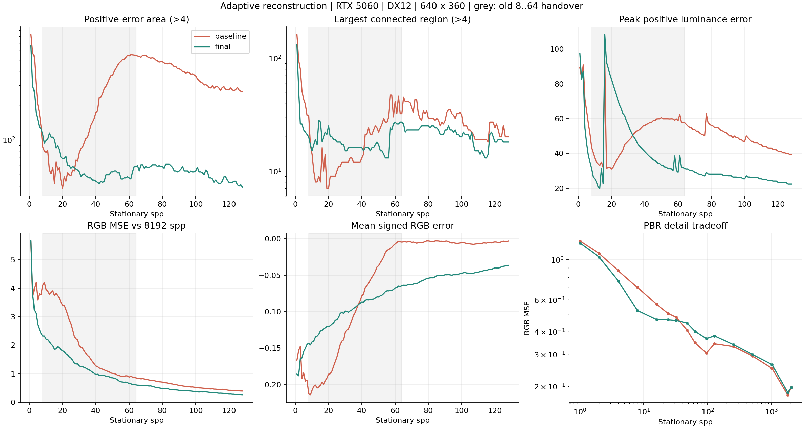
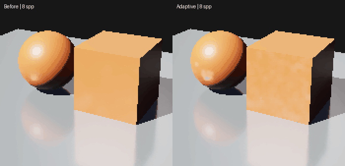
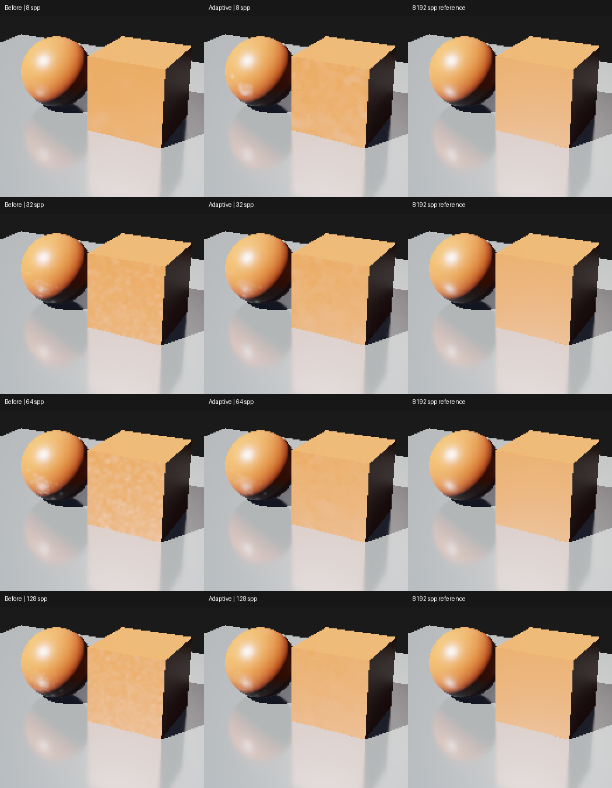

# M5：按局部误差控制反射重建

日期：2026-10-27。对照显示 Shader 为 `116754d`。用户反馈固定阶段交接使白点先扩散变大、随后缩小。本次移除 8–64 spp 的显示交接及 Resolve 后置 5×5 核，改用与 progressive 匹配的中心矩、稳定控制值和同一条多尺度重建链。[算法/资源契约](../temporal-reflections.md)、[设计理由](../../design/design-review.md#局部误差与重建足迹)、[完整数据](m5-adaptive-reflections/summary.json)。

这是有偏显示重建的试验性改进，保留未滤波参考；不是完整 SVGF/NRD，没有输入高光截断、自适应射线采样或积分器修改。

## 改动

- 每个 progressive 双缓冲槽增加一个八字节/像素结构化缓冲：原始单帧去调制亮度的 `M2/N` 和稳定控制值。前帧均值来自匹配的未滤波 RGB，当前样本只计入一次。显示关闭时仍更新统计，保证重新打开后没有缺失样本。
- 中心矩保持逐像素原值；控制目标参考同表面 3×3 邻域的前帧矩，短历史补充当前空间方差。控制值按目标的 1/8 更新，每帧最大减 .04、增 .02。
- 首尺度根据局部误差和样本支持连续结合 progressive 与时间先验；明显超出误差估计的先验差异会降低其权重。小尺度可及时响应高方差尖峰，大尺度使用稳定控制值的二次方、四次方，优先减弱。
- 中间 alpha 传播近似滤波方差，保留相关样本的经验下限。Resolve 恢复材质并保留 2048 spp/镜面等旁路，不再执行额外空间核。空间结果不反馈时间历史或原始均值。

均值方差由普通样本方差近似；Sobol 样本相关，显示信号还存在预滤波/重投影相关性，因此它是控制滤波的指标，不是经过校准的概率置信区间。算法仍可能有细节模糊、负偏差和零星高光尖峰。

## 连续静止序列

RTX 5060 / NVIDIA 591.74，MSVC Release，双后端，validation on，640×360、128² 阴影。三个场景：原 RayTracing（太阳强度 3）、其内存强光变体（强度 12）和原 PBR。源资产未改。每次独立创建 Renderer，从相同姿态与采样零连续累积，保存前 128 帧每一帧及 256/512/1024/1800/2048 spp；2048 后关闭显示降噪，继续到 8192 spp 参考。全部六组版本间 2048/8192 spp 图像逐字节相同。

新旧显示使用同一宿主；旧版忽略新增统计输入。强光 DX12 的旧版检查点另与 `116754d` 原宿主既存图比较，12 个检查点全部逐字节相同。最终组保存并核对实际加载的三个 Shader 源文件 SHA256。错误 Shader 副本下启动过的一组采集已隔离，未进入结果。

指标在原始 BMP 的 8-bit tone-mapped RGB 上计算。亮度误差用整数 Rec709 系数 `(2126*dR+7152*dG+722*dB)/10000`；记录正误差 >4、>8、>16 的像素面积和八邻接连通区域。这是相对参考的误差足迹，不是白点检测器。8192 spp 参考仍有噪声，且共享采样前缀，不是独立真值。完整图包含初始 1..128 spp；下面的区间从旧交接起点 8 spp 起计算。

强光 DX12，8..128 spp 平均；Vulkan 接近：

| 指标 | 旧版 | 当前 | 变化 |
| --- | ---: | ---: | ---: |
| 正亮度误差 >4 的面积，像素 | 307.78 | 56.56 | -81.6% |
| 最大连通区域面积，像素 | 23.69 | 19.74 | -16.7% |
| 正亮度误差 >8 的面积，像素 | 76.24 | 25.73 | -66.3% |
| 正亮度误差 >16 的面积，像素 | 15.70 | 8.95 | -43.0% |

旧版面积在 32–64 spp 明显增大；当前不再出现同样的整体上升。但单个亮斑仍可能出现或变大：例如 16 spp 的峰值正亮度误差约 111，旧版约 94。面积更小不代表所有尖峰都更低。



左旧、右新，强光同姿态 8..128 spp、隔帧播放，100ms/帧以便观察，不表示实时 FPS。GIF 使用固定调色板，数值指标来自原始 BMP。



8/32/64/128 spp 的原像素局部放大两倍；第三列是相同区域的 8192 spp 参考：



### 图像误差与细节取舍

| DX12 场景 | spp | 旧 RGB MSE | 当前 RGB MSE |
| --- | ---: | ---: | ---: |
| 原光强 3 | 64 | .36593 | .33310 |
| 原光强 3 | 128 | .17454 | .15589 |
| 原光强 3 | 256 | .08959 | .08173 |
| 强光 12 | 64 | .85430 | .61073 |
| 强光 12 | 128 | .39838 | .25794 |
| 强光 12 | 256 | .18629 | .12931 |
| PBR | 64 | .34652 | .40112 |
| PBR | 128 | .34246 | .37832 |
| PBR | 256 | .33054 | .33885 |

强光 128/256 spp 误差约下降 35%/31%；PBR 64/128 spp 约增大 16%/10%。强光 64 spp 全图有符号 RGB 误差从 -.0045 变为 -.0643，负偏差增大；先验、空间滤波仍可能损失高光和细节，不能把面积下降全部解释成无损去噪。较宽/较窄候选、先验差异限制及粗糙度限制实验也保留在 summary；未保留没有明显收益的额外粗糙度调节。

## 移动与停止

独立强光序列预热 64 帧，以局部 X=.08、yaw=.8° 每帧移动 16 帧，停止 128 帧，再移动 16 帧；停止终点另采 8192 spp。DX12 在停止后 33/65/129 spp 的 MSE 从 1.798/.812/.402 降为 .987/.490/.221，Vulkan 接近。静止重建没有写回时间 radiance/moments；再次移动仍从独立单帧重投影历史工作。

既有完整运动验收另含 gentle/fast/reveal，每姿态参考 256 spp、终点参考 2048 spp。DX12 gentle/fast 平均 MSE 约从 5.482/7.043 降到 5.244/6.525；残差差分 MSE 从 .29469/2.43952 变为 .30099/2.51352，约增加 2.1%/3.0%。reveal 的图像误差及差分均下降。该差分没有运动矢量 warp，并非纯主观闪烁指标；没有声称移动时所有指标都改善。完整双后端逐帧数据在 summary。

## 成本、预算与验证

720p Release Player、validation off、原光强 3、128² 阴影，预热 64、测量 128 帧（65..192 spp）。单次串行短测，不代表窗口 FPS 或长期性能。双方均使用当前宿主和 Statistics Pass，只替换显示 Shader，对照不是完整旧可执行文件复测：

| 后端 | 旧显示/当前七个统计与重建 Pass 合计 ms | 当前 Statistics ms | 当前串行帧 ms |
| --- | ---: | ---: | ---: |
| DX12 | 1.317 / 1.359 | .083 | 3.312 |
| Vulkan | 1.197 / 1.199 | .070 | 2.944 |

新增持久统计合计 16 字节/像素/缓存 View，720p 理论 14.06 MiB，1440p 为 56.25 MiB；最多沿用四个 progressive View 缓存。Stats Buffer 的初始化与纹理独立跟踪，允许等像素数尺寸切换保留缓冲并正确同步。更多 View 或资产仍可能触及预算。

本轮发现窗口请求 2560×1440 会受到桌面限制。profile 的 width/height 来自请求参数，不能当实际尺寸证据；本轮窗口 graph 显示实际为 2,716,160 像素，32 帧运行通过。随后补测**实际 2560×1440 离屏目标、32 帧、两个在途帧上下文**，目标尺寸、Graph 资源字节数及逐帧 spp 均核对通过。tracked native 高水位 DX12/Vulkan 为 **1818.69/1817.75 MiB**，低于默认 2048 MiB；没有提高预算。此值包括上传等 tracked native 分配，不等于驱动实时显存占用。真实 1440p 窗口展示仍未验证。

Debug/Release Sandbox/Player 构建通过；Debug 的一次 PDB 写冲突使用进程内 `/FS` 重建解决，未改构建系统。Release 既有双后端反射完整序列、AS/Shader 合约、持续窗口共 6/6；Debug AS/Shader 合约 2/2。另有 16 次静止/停止恢复采集、双后端 512 样本中心矩数值探针（含迟到高能样本，最大相对偏差约 5.64e-7，控制变化上限符合 .02/-.04）、重置/计数上限/镜面/背景检查。两后端各完成 640×360 →720×320 →480×480 →640×360 的等像素数切换，每尺寸 16 帧，首帧矩重置与资源状态检查通过。上述 GPU validation errors=0，关闭后 ledger=0。其他 GPU/4K 未验证。

## 使用与复现

默认使用新重建，无新增开关；内置 Shader 在创建 Renderer 时加载，运行中的程序需重启。使用本次构建：

```powershell
out/build/m5-release/renderlab_sandbox.exe --backend vulkan --project sample/m4/RayTracing.rlproject --pipeline raytracing --debug-panel
```

Raw/History 查看原始单帧或未滤波平均，Denoised 查看重建；关 Temporal 可回原空间基线。固定相机检查点仍可用上一份报告的 CLI：N spp 截图采用预热 N-2、测量 1（最后额外截图为 N）。连续序列、数值及窗口探针的本机源码/原始图位于 `out/m5-adaptive/`，没有加入常规 CI 或通用 Benchmark 接口。

```powershell
ctest --test-dir out/build/m5-release -R "gpu\.(dx12|vulkan)\.(reflections|acceleration_structure|reflection_window)$" --output-on-failure
```
