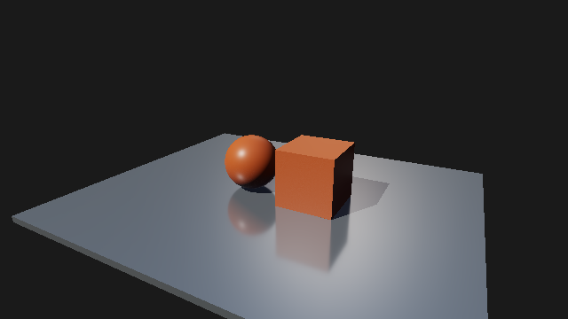
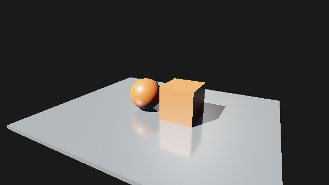

# M5：静止反射收敛与白点修复

日期：2026-10-27。用户报告参考场景在强光面、高光和反射高光中，静止等待后仍有较多白点。

## 原因与修改

- 原历史计数被限制为 63，后续每帧固定用 1/64 混合，形成指数平均；等待更久不会持续降低噪声。这不是完整的渐进收敛。
- 原 GGX NDF 采样在掠射角会产生较大的 BRDF/PDF 权重。改为 Heitz 2018 的可见法线 GGX（VNDF），使用匹配 PDF，非 Fresnel 权重为 G2/G1(V)，有界于 1。
- 使用逐像素数字扰乱的 2D Sobol 序列；静止时持续按 1/(N+1) 更新均值，序列不再在 2^20 提前绕回。在 2^24（float 能准确表示连续整数的上界）保持已完成结果，不切回 EMA。
- 面板/报告显示实际反射 spp 和观察到的历史重置次数。原始单样本查看仍固定 sample zero；相机/场景/材质/尺寸/照明变化仍清空历史。

未降低原场景光强、曝光或材质高光，也未加入辐射亮度裁剪或降噪器。VNDF 降低采样方差；此修复仍是一次混合反射，不是 Path Tracing。

## 图像对照

RTX 5060 / NVIDIA 591.74，MSVC Release，validation off；固定相机，640×360，128² 阴影。分别导出 256、2048、8192 spp。更强光照通过临时项目副本只把方向光 intensity 从 3 改为 12，原始源资产不变。

MSE 是最终 8-bit sRGB RGB 分量与同后端修正版 8192 spp 参考图的均方误差；不是 HDR 方差。参考包含较小采样数的前缀，不能作为独立真值或无偏性的证明。亮点指标统计绝对误差 >32/255 的 RGB 分量数，不把正常高光本身判为异常。旧版只保留了 DX12 对照，未声称旧版 Vulkan 数字。

| 方向光强度 | 后端 | 版本 | spp | RGB MSE | 误差 >32 的分量 |
| --- | --- | --- | ---: | ---: | ---: |
| 3 | dx12 | before | 256 | 2.504583 | 298 |
| 3 | dx12 | before | 2048 | 2.384881 | 271 |
| 3 | dx12 | after | 256 | 0.678511 | 0 |
| 3 | dx12 | after | 2048 | 0.030395 | 0 |
| 3 | vulkan | after | 256 | 0.678478 | 0 |
| 3 | vulkan | after | 2048 | 0.030489 | 0 |
| 12 | dx12 | after | 256 | 1.571522 | 76 |
| 12 | dx12 | after | 2048 | 0.075054 | 0 |
| 12 | vulkan | after | 256 | 1.572216 | 76 |
| 12 | vulkan | after | 2048 | 0.075231 | 0 |

原场景修正版从 256 到 2048 spp 的误差约降低 95.5%；旧版相同等待区间误差基本不降。强度 12 的两个后端也约降低 95.2%。这支持“静止等待会继续改善”的修复结论，不保证任意场景、任意强度在固定帧数完全无噪声。

旧版 2048 spp：


修正版 2048 spp，原场景光照：



修正版 2048 spp，方向光强度 12：



数值和限制见 [summary.json](m5-convergence/summary.json)。原始 BMP、JSON 报告和日志在忽略目录 `out/m5-convergence`。

## 验证入口

- `gpu.{dx12,vulkan}.acceleration_structure`：实际 GPU 上六组 roughness/view（含掠射角），每组 4096 次采样，验证法线/权重有限、权重 <=1、Sobol 象限分层；实际 Accumulate Shader 验证 reset、1/128、1/2048 权重与最大计数保持。
- `gpu.{dx12,vulkan}.{reflections,ray_query_scene}`：静止 130 帧计数持续增长；相机移动再停止不反复重置；保留原有 ViewID/在途/材质/尺寸/光照失效验证。
- 原始模式故意不累积；交互复测选择 Final 或 Reflection (history)，重启新程序后观察 `RT history: N spp` 随静止时间增长。

```powershell
out/build/m5-release/renderlab_sandbox.exe --backend dx12 --headless --validation off --project sample/m4/RayTracing.rlproject --pipeline raytracing --denoise off --width 640 --height 360 --quality low --warmup-frames 0 --benchmark 2047 --output out/m5-convergence/repro
```

Debug 所选 16/16、Release 光追专项 4/4 通过，双后端原生窗口各 54 帧、10 次重建，validation errors=0。

最后单独导出的一帧为第 2048 spp。用 `--backend vulkan` 复测另一后端。通用历史/材质边界见 [光追接口](../raytracing.md)。
