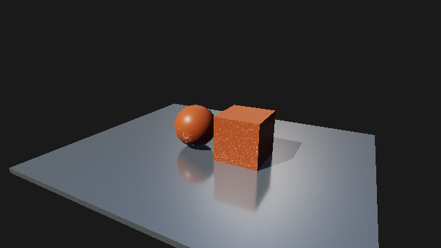
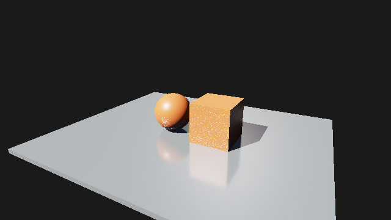

# M5：反射空间降噪

日期：2026-10-27。对静止 1/N 累积增加可选空间滤波，改善低 spp 下的反射噪声。此处记录单独空间滤波基线；后续默认叠加的 [时间重投影](m5-temporal.md) 可用 `--temporal-denoise off` 关闭。

## 实现与范围

独立 `RayTracing.Reflection.Denoise` Compute Pass 位于 Accumulate 与 Combine 之间，读取未滤波历史、本帧随机反射命中距离，以及主表面深度、世界法线、粗糙度和 Albedo/Metallic。5×5 联合双边核保护主几何/材质边界，以软权重限制命中距离差异；没有亮度裁剪、降低光强或曝光。低粗糙度 ≤0.05 的镜面旁路，0.15 起使用完整粗糙度权重；滤波强度随 spp 衰减，2048 spp 起完全旁路。

滤波结果只供显示，永不回写持久历史。Final/HDR 默认开启，可用面板 **RT spatial denoise (Final / HDR)** 或 `--denoise on|off` 切换；Texture 保留 Raw / History / Denoised。开关和 History/Denoised/Final 切换不重置历史，Raw 仍固定样本零。

## 图像对照

RTX 5060 / NVIDIA 591.74，MSVC Release / validation off。固定相机、640×360、128² 阴影；原场景方向光强度 3，强光副本仅提高到 12。每组分别运行相同采样前缀，最后捕获帧为指定 spp。

下表 MSE 使用最终 8-bit sRGB RGB，与同后端 **未滤波 8192 spp** 参考比较；参考包含低 spp 前缀，不是独立真值，也不是 HDR 方差或无偏性证明。误差 >32 统计 RGB 分量绝对差超过 32/255 的数量。

| 后端 | 光强 | spp | 未滤波 MSE | 降噪 MSE | 未滤波误差 >32 | 降噪误差 >32 |
| --- | ---: | ---: | ---: | ---: | ---: | ---: |
| dx12 | 3 | 2 | 14.165587 | 6.481071 | 692 | 590 |
| dx12 | 3 | 16 | 7.524845 | 2.646813 | 579 | 283 |
| dx12 | 3 | 64 | 3.410143 | 1.567555 | 529 | 215 |
| dx12 | 3 | 256 | 0.678511 | 0.517034 | 0 | 0 |
| dx12 | 3 | 2048 | 0.030395 | 0.030395 | 0 | 0 |
| dx12 | 12 | 2 | 13.323144 | 8.063631 | 2374 | 1268 |
| dx12 | 12 | 16 | 9.323325 | 4.267805 | 1553 | 477 |
| dx12 | 12 | 64 | 5.745349 | 2.830272 | 746 | 329 |
| dx12 | 12 | 256 | 1.571522 | 1.190677 | 76 | 35 |
| dx12 | 12 | 2048 | 0.075054 | 0.075054 | 0 | 0 |
| vulkan | 3 | 2 | 14.156897 | 6.481165 | 692 | 590 |
| vulkan | 3 | 16 | 7.524333 | 2.646889 | 579 | 284 |
| vulkan | 3 | 64 | 3.410045 | 1.567156 | 529 | 215 |
| vulkan | 3 | 256 | 0.678478 | 0.517548 | 0 | 0 |
| vulkan | 3 | 2048 | 0.030489 | 0.030489 | 0 | 0 |
| vulkan | 12 | 2 | 13.322036 | 8.064201 | 2373 | 1268 |
| vulkan | 12 | 16 | 9.323122 | 4.268461 | 1553 | 478 |
| vulkan | 12 | 64 | 5.744528 | 2.830333 | 746 | 329 |
| vulkan | 12 | 256 | 1.572216 | 1.190985 | 76 | 35 |
| vulkan | 12 | 2048 | 0.075231 | 0.075231 | 0 | 0 |

两后端原场景 16 spp 的 MSE 均下降约 64.8%，强光场景下降约 54.2%；强光误差 >32 的分量由 1553 降到约 478。两场景、两后端 2048 spp 的开关 RGB 逐字节一致。滤波在这些输入下降低误差，不保证所有场景都改善。

原场景 16 spp，关闭：



原场景 16 spp，开启：


强光 16 spp，关闭：



强光 16 spp，开启：


## GPU 成本

原场景、1280×720、128² 阴影；Release / validation off，预热 32 帧后测量 128 帧，每个模式单次短测。测量区间为 33..160 spp，降噪权重随 spp 变化；没有相机移动。GPU timestamp 仅描述 Pass；串行帧时包含 CPU/提交/等待，不代表窗口 FPS，也不是长测或稳定提升保证。

| 后端 | 关闭串行帧均值 ms | 开启串行帧均值 ms | Denoise GPU 均值 ms | Denoise GPU min..max ms |
| --- | ---: | ---: | ---: | --- |
| dx12 | 1.8753 | 2.0410 | 0.2475 | 0.2306..0.3908 |
| vulkan | 1.3452 | 1.6354 | 0.2216 | 0.2207..0.2248 |

其他 Pass、内存高水位和完整均值保存在 summary.json；单次配对不排除 GPU 时钟、驱动与系统调度影响。

## 验证和限制

MSVC Debug/Release Sandbox/Player 构建完成。RTX 5060 上 Debug 所选 16/16、Release 光追专项 4/4 通过。双后端额外 RT 窗口各 54 帧、10 次重建/挂起，257×193 Player 在 `--view reflection-denoised --denoise off` 下通过（诊断视图独立于 Final 开关）。GPU 验收、窗口和 Player 的 validation errors=0；既有 clear-value/未消费顶点属性性能警告仍存在。

GPU 合约入口 `gpu.{dx12,vulkan}.acceleration_structure`：真实 Denoise Shader 验证 9×7 非整工作组尺寸、常量保持、孤立噪点抑制、alpha 保持、镜面/高 spp 旁路、背景/Unlit、深度/法线边界和命中距离引导。场景验收还检查四个独立 Pass、Final 开关的图像差异、未滤波历史不受开关污染、切换视图/开关不重置 spp，保留原收敛与失效测试。

当前随机命中距离不是稳定的反射深度，主表面 GBuffer 不能完整识别反射中的材质/照明边界；有限空间邻域仍会模糊小细节、产生低 spp 空间偏差，且不能去掉全部白点。没有运动矢量、重投影、时间降噪或方差估计；运动仍重置累积。只过滤反射，Deferred 直接光和 Ray Query 硬阴影不经此 Pass。其他 GPU 未验证。

RGBA32F 命中引导和滤波输出共增加 32 字节/像素的瞬态资源，640×360 约 7.03 MiB、1280×720 约 28.13 MiB（不含对齐）。关闭滤波仍写入命中引导，高 spp 旁路仍执行复制 Pass；后续压缩或变体优化需单独评估。

## 高分辨率窗口预算修复

原空间降噪提交后的 640×360 窗口验证未覆盖高分辨率启动。收到用户报告后，在 Vulkan 的 1920×1080 RT 原生窗口复现 `RHI allocation budget exceeded`；M1 沿用的 256 MiB native ledger 上限无法覆盖当前 GBuffer/HDR、反射历史与降噪和在途帧。此前 720p 串行测量不会证明高分辨率窗口成立。

上文图像与成本数据在预算修复前采集（当时限额 256 MiB）；本修复不改变 Shader。

Sandbox/Player 场景启动时显式配置 2048 MiB tracked allocation 上限，独立 RHI Demo 保留 256 MiB；`--gpu-budget-mib N`（64..16384）允许设置其他有界上限。SceneRenderer Graph 缓存取该值的 3/4，为图外资源留余量。零值或低于当前 native 占用的 Runtime 设置被拒绝，预算耗尽诊断列出 requested/used/limit。此设置不预留显存，也不代替设备实时内存预算查询。没有压缩现有图像或改变滤波结果。

修复后 Debug / validation on / 固定相机，每个后端每个尺寸连续 32 帧，场景阴影使用 512²：

| 后端 | 分辨率 | native ledger 高水位 MiB |
| --- | --- | ---: |
| dx12 | 1920×1080 | 658.00 |
| dx12 | 2560×1440 | 871.75 |
| vulkan | 1920×1080 | 365.25 |
| vulkan | 2560×1440 | 870.87 |

修复后 Debug 所选 18/18、Release 光追/1080p 窗口专项 6/6 通过，Release Player 两后端另各完成 1080p 16 帧，validation errors=0；关闭后 ledger 归零。

两后端另以 1920×1080 启动既有 resize/minimize 与三管线菜单测试，各 54 帧/10 次重建/10 次挂起通过，validation errors=0。新增长期回归 `gpu.{dx12,vulkan}.reflection_window` 在 1920×1080 固定窗口持续渲染 16 帧，不在早期缩小窗口；显式预算/耗尽账本不变/非法缩小/owner-thread 由 CPU 合约验证。以上不是泄漏长测或其他 GPU/4K 支持保证。历史帧、缓存、GPU 完成时机和原生对齐会影响高水位，不能按分辨率简单线性外推。

## 复现

```powershell
out/build/m5-release/renderlab_sandbox.exe --backend dx12 --headless --validation off --project sample/m4/RayTracing.rlproject --pipeline raytracing --denoise on --temporal-denoise off --width 640 --height 360 --quality low --warmup-frames 0 --benchmark 15 --output out/m5-denoise/repro
```

最后另行捕获的一帧为第 16 spp。用 `--denoise off` 比较同一未滤波前缀，`--backend vulkan` 复测另一后端。8192 spp 基准按 [收敛记录](m5-convergence.md) 用 `--denoise off` 生成。强光副本保留资产 ID/引用、只修改方向光强度，源场景不变。全部指标见 [summary.json](m5-denoise/summary.json)，原始 BMP/日志/报告保存在忽略目录 `out/m5-denoise`。接口和参数公式见 [光追文档](../raytracing.md)。
