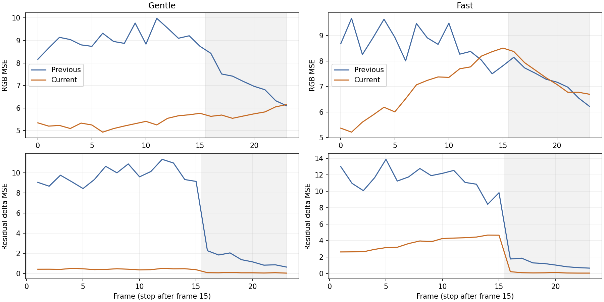
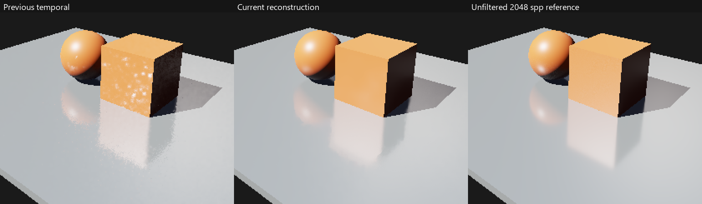
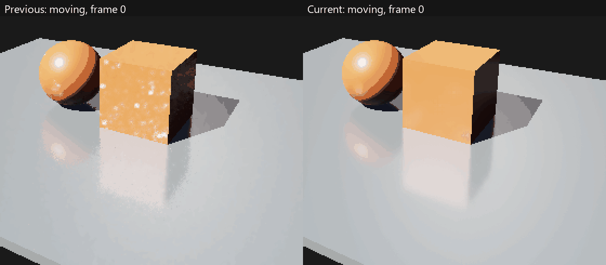

# M5：运动反射白点稳定性修复

日期：2026-10-27。当前显示分支改为独立单帧去调制、稳定命中引导、接收表面/局部平面反射重投影、时间亮度矩、三尺度方差引导滤波和材质 Resolve。未滤波采样与 1/N 均值保持独立。输入亮度不做硬截断，显示历史裁剪和空间滤波仍有偏差。[接口/布局/限制](../temporal-reflections.md)、[参考依据与取舍](../../design/design-review.md#运动反射白点闪烁设计复查)。

本报告保留 `3b8f8bf` 的测量。后续静止 Resolve 修复及新的静止/停止恢复结果见 [静止显示收敛](m5-stationary-reflections.md)，不以新版本结果覆盖本页历史数据。

## 完整序列与指标

RTX 5060 / NVIDIA 591.74，Release，DX12/Vulkan，validation on，640×360、128² 阴影。RayTracing 样例太阳强度在内存中从 3 提高到 12，源资产未修改。每模式从清空历史的相同姿态与采样序列开始，预热 8 帧，移动 16 帧，再停止 8 帧。每个移动姿态单独生成未滤波 256 spp 参考，停止阶段复用最终姿态参考；另保留终点 2048 spp。三个模式为未滤波 Final、原空间基线和时间重建。

| 轨迹 | 每移动帧局部 X 平移 | 每帧 yaw | 用途 |
| --- | ---: | ---: | --- |
| gentle | .02 | .15° | 慢速移动 |
| fast | .08 | .8° | 快速移动 |
| reveal | .12 | -.6° | 横移并反向转头，增加遮挡显露 |

所有误差在最终 8-bit tone-mapped RGB 分量上计算。令 `e[t] = output[t] - reference[t]`，记录全序列平均 `MSE(e[t])`、`MSE(e[t]-e[t-1])`、有符号均值以及正误差 >16 的 RGB 分量比例。后者不是白点像素检测器。残差差分扣除了参考画面的真实运动变化，但没有对误差图做运动矢量 warp，仍包含边缘/滤波偏差；不能当作纯噪声或主观闪烁的独立度量。有限 spp 参考仍有噪声，且与被测序列共享部分采样，不能视作独立真值。

修改前保存的 DX12 原时间滤波与当前实现对照：

| 轨迹 | 原时间平均 RGB MSE | 当前平均 RGB MSE | 原残差差分 MSE | 当前残差差分 MSE | 差分下降 |
| --- | ---: | ---: | ---: | ---: | ---: |
| gentle | 8.40041 | 5.48199 | 6.84898 | .29469 | 95.7% |
| fast | 8.17810 | 7.04328 | 7.89823 | 2.43950 | 69.1% |

平均图像误差分别下降约 34.7%/13.9%。原时间历史像素接受率已高于 99.7%，平均混合权重约 .797/.753；当前约 .943/.942。来源帧计数与是否完全拒绝历史都不足以独立解释稳定性。当前同时调整了引导、重投影、统计与重建，以上是整体改进，不把所有收益归于单一因素。



灰色区域为停止阶段。快速运动末段与停止后的部分帧，当前 MSE 仍高于旧版；终点对 2048 spp 的快速 MSE 约 7.24，旧版约 6.66。全图平均有符号误差从慢/快的 -.136/-.139 变为约 -.210/-.239，存在更大的负偏差，局部高光损失不能用全图小均值排除。反射边缘与细节也更柔和。没有把较低残差差分单独当成无拖影或无亮度损失的证明。

快速终点局部，依次为原时间滤波、当前结果、2048 spp 参考，原像素放大两倍：



同一 24 帧序列的局部动画，左旧右新，100ms/帧用于观察，播放速度不表示实时 FPS。GIF 使用固定调色板；数值指标来自原始 BMP：



Vulkan 的相同三条轨迹与两种基线也保留于 [summary.json](m5-reflection-stability/summary.json)。修改前的完整序列基线只采集了 DX12 的 gentle/fast；没有补造 Vulkan/reveal 的旧时间数据。其他 GPU、动态物体、通用曲面镜像跟踪与 4K 未验证。

## 输入亮度截断实验

评估过以当前邻域中位数/上四分位数构造输入亮度上限。对应同版本的截断/未截断实验中，gentle 平均 MSE 约 7.79/5.47，fast 约 9.35/7.11。截断进一步压低残差变化，但损失真实次级高光。最终撤去输入截断；原始积分器、光强、曝光与 progressive 均值未用这种截断换取改善。匹配实验数据保留于 summary 的 `rejectedInputCapExperiment`，与后续引导修正后的最终实现分开记录。

## 成本与内存

性能测量使用 Release Player、validation off、原光强 3、1280×720、128² 阴影，预热 32/测量 128 帧。固定相机，测量时 progressive 为 33..160 spp；单次 headless 串行等待短测，不代表窗口吞吐或长期分布。各 Pass、CPU/等待、内存高水位和设备版本保留于 summary 的 `cost`。

八张持久 RGBA32F 历史增加到 128 字节/像素，1440p 为 450 MiB；Prepare/三个滤波尺度/Resolve 交替使用两张版本化中间纹理。普通帧只使用 1×1 诊断目标，开启逐像素 readback 才分配全尺寸诊断。初始每阶段独立目标、始终写全尺寸诊断的版本，在 1440p native 高水位约 1672/1672 MiB；此结果用于发现资源成本，不作为最终布局的占用数据。tracked limit 默认 2048 MiB，不是物理显存预留或驱动实时预算。

| 后端 | 原空间基线串行帧 ms | 当前串行帧 ms | 当前六个重建 GPU Pass 合计 ms | 1440p 窗口 native 高水位 MiB |
| --- | ---: | ---: | ---: | ---: |
| DX12 | 1.914 | 2.835 | .992 | 1312.5 |
| Vulkan | 1.696 | 2.547 | .862 | 1311.5 |

1440p 数据为 validation on、固定窗口各连续 32 帧，两个在途帧上下文。复用资源后，上述完整运动验收保存的 586 张 BMP 与复用前逐字节相同。最终布局的 GPU 成本按新版本重新测量，没有用旧布局的成本代替。其他场景/分辨率可能仍触及预算。

## 验证与复现

- GPU 合约覆盖 9×7 边界、常量、噪声、源重置、整数/亚像素重投影、遮挡/法线/粗糙度拒绝、历史长度和权重、虚拟路径、时间矩，以及镜面/高 spp/背景/Unlit 旁路。
- 新增 Prepare/三个滤波尺度/Resolve 的常量、材质去调制往返、稳定命中距离、稀有亮样本保留与精确旁路。
- 场景检查独立的九个反射 Pass、相机运动/切换/剪切、场景/材质/光照/尺寸失效、原始历史与时间历史隔离、两个在途版本；逐像素诊断记录权重/长度/路径/距离。
- 默认 Debug 序列使用每姿态 32 spp、终点 128 spp 专注验证和生命周期；完整画质数据采用 Release 的 256/2048 spp。两配置生成的 JSON 都记录实际参考计数。一次额外的完整参考 Debug DX12 PBR 场景已运行通过（资源收紧前，约 464 秒），不把缩短后的 Debug 数据当作同精度画质证据。
- 持续 1080p 与 1440p 固定窗口检查实际尺寸；普通 `--window-test` 会先缩小窗口，不能据此声称通过高分辨率检查。关闭后 ledger 必须归零。
- 最终 Debug 所选 17/17；追加 RenderGraph 与双后端 AS/新 shader 合约 3/3；Release 双后端反射完整序列、AS、持续 1080p 6/6。GPU/窗口 validation errors=0，关闭后 ledger 归零。新增合约明确验证虚拟 UV 选择不同于接收表面 UV，以及半支持 bilinear 归一化后的权重。
- 两后端另用 257×193、预热 2047 帧/测量 1 帧，时间开关输出 BMP 逐字节相同。报告对应测量帧 2048 spp，额外截图实际为 2049 spp；精确 2048 分支由直接 GPU shader 合约检查。没有把截图的 spp 误写为测量帧 spp。

```powershell
out/build/m5-release/renderlab_sandbox.exe --backend vulkan --project sample/m4/RayTracing.rlproject --pipeline raytracing --debug-panel --denoise on --temporal-denoise on
```

对照面板 **RT denoise (Final / HDR)**、**Temporal reprojection (requires denoise)**。Raw/History 保留未滤波结果；Denoised 显示新重建分支。头部来源帧数不是 GPU 接受像素数。

```powershell
ctest --test-dir out/build/m5-release -R "gpu\.(dx12|vulkan)\.(reflections|acceleration_structure|reflection_window)$" --output-on-failure
```

序列输出位于 `out/build/m5-release/reflections/BACKEND/sequence/`，JSON 为 `sequence-{gentle,fast,reveal}.json` 与 `temporal-motion.json`；轨迹定义在 `reflection_temporal_motion.cpp`。真实 GPU shader 合约由 `--as-test` 运行。阶段关闭情况以 [阶段计划](../../design/phaseplan.md) 为准。
