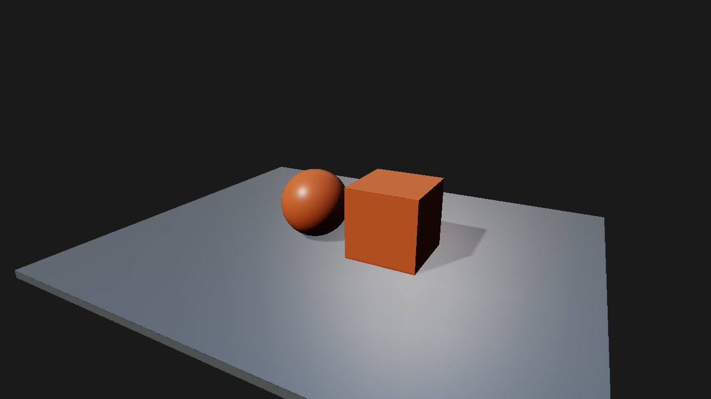
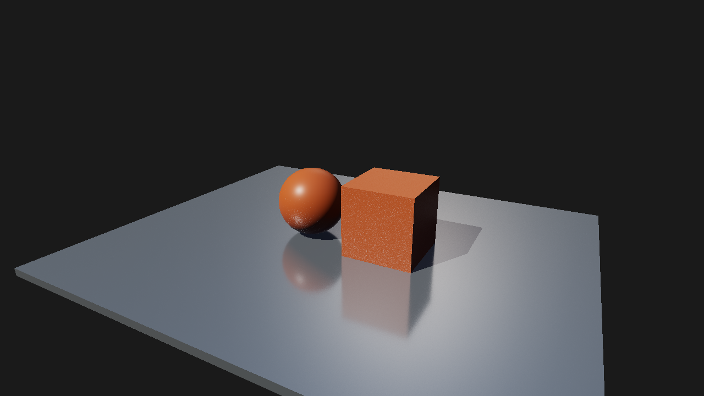

# M5 混合反射：RTX 5060 参考与成本

此记录对应 M5 初版（64 帧后 EMA），保留为历史成本基线。2026-10-27 的持续收敛修复与新图见 [收敛修复](m5-convergence.md)；本表不代表修复后采样代码的最新成本。

日期：2026-10-26。MSVC Release/NMake，HLSL `-O3`，RTX 5060，NVIDIA 591.74（Windows 32.0.15.9174），validation off；固定 RayTracing 项目相机/曝光，1280×720，512² 光栅阴影，串行 headless。每项一轮，64 帧预热、240 帧测量；六项顺序运行，测量期间没有并发构建或其他 GPU 验收。

## 实测

单位为 ms；显存为 RHI usedBytes（MiB），不是整个进程或驱动占用。GPU 合计只覆盖图中 timestamp 包围的 Pass，不包含完整屏障、提交、读回等范围；串行帧时不等同窗口 FPS。

| 后端 | 管线 | GPU Pass 合计 | CPU render | 串行帧均值 | RHI MiB |
| --- | --- | ---: | ---: | ---: | ---: |
| dx12 | forward | 0.0653 | 0.4371 | 0.5691 | 28.6 |
| dx12 | deferred | 0.1124 | 0.7002 | 0.9946 | 73.6 |
| dx12 | raytracing | 0.3932 | 0.8986 | 1.5131 | 142.8 |
| vulkan | forward | 0.0603 | 0.4200 | 0.5779 | 27.9 |
| vulkan | deferred | 0.1097 | 0.5601 | 0.9023 | 72.9 |
| vulkan | raytracing | 0.3270 | 0.7146 | 1.2984 | 142.1 |

反射部分的独立 GPU 均值：

| 后端 | Ray Query 阴影 | TraceRays 反射 | 静止历史累积 | 反射合成 |
| --- | ---: | ---: | ---: | ---: |
| dx12 | 0.0383 | 0.0960 | 0.0813 | 0.0651 |
| vulkan | 0.0405 | 0.0837 | 0.0294 | 0.0581 |

这是有限场景的短测成本记录，不能据此断言后端优劣、长尾分布或复杂场景的性能。首帧 Shader 编译和 BLAS/TLAS 构建在预热中，不计入稳定帧；反射每帧仍追踪新样本。当前组合仍生成光栅阴影图，供固定布局和 Forward 透明接收使用，该成本包含在合计内。数值、样本数、各项 min/max、驱动与显存见 [summary.json](m5-reflections/summary.json)。原始报告和 JSONL 在 `out/m5.4-release`，未作为源资产提交。

## 参考图

截图在预热与测量后另行导出。反射是一次 specular bounce，具有有限样本噪声，无空间降噪；图集按 64×64 重采样、显式 LOD 0。透明与 Masked 的边界、历史失效及 API 见 [光追接口](../raytracing.md)。

Deferred 纯光栅：



Ray Query 阴影与 TraceRays 混合反射：



Forward 对照保存在 [dx12-forward.png](m5-reflections/dx12-forward.png)。

## 复现

```powershell
out/build/m5-release/renderlab_sandbox.exe --backend dx12 --headless --validation off --project sample/m4/RayTracing.rlproject --pipeline raytracing --width 1280 --height 720 --quality medium --warmup-frames 64 --benchmark 240 --profile out/m5.4-release/dx12-raytracing.json --output out/m5.4-release/raytracing
```

将后端改为 `vulkan`、管线改为 `forward` / `deferred` 得到其余配置。该 NMake 构建目录是本机入口；通用工具链与构建步骤见 [手册](../../manual/build.md)。Debug/validation 另通过所选 16 项验收，Release/validation 的 AS/TraceRays 与反射专项 4/4；双后端窗口各 54 帧、10 次重建，并实际切换三种管线。其他 GPU、WARP、移动相机重投影与降噪尚未验证/实现，不计通过。
