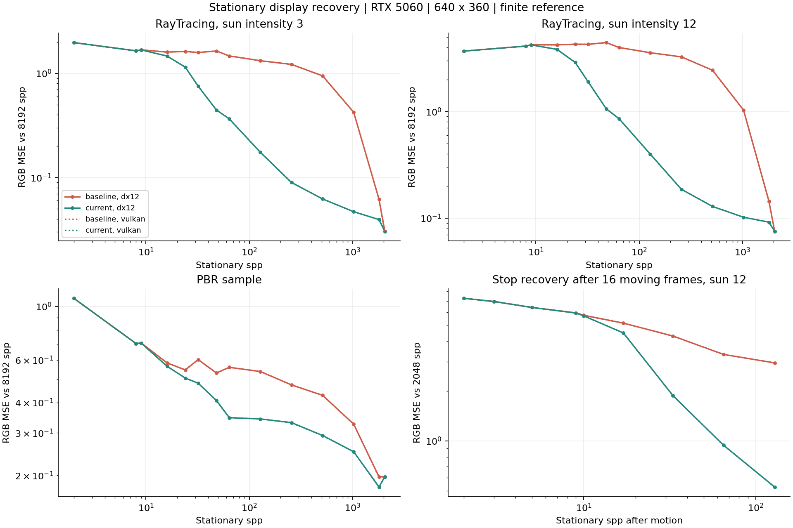
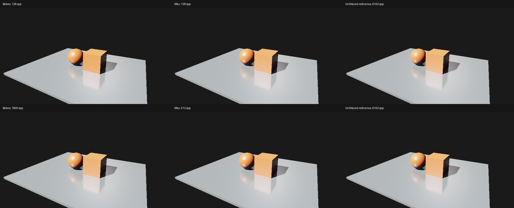

# M5：静止反射显示恢复

日期：2026-10-27。基线为 `3b8f8bf`。用户反馈相机不动时仍需约 1800 spp 才达到理想效果。本次修改 `ReflectionReconstruct.hlsl` 的 Resolve；射线采样、PDF、1/N 均值、重投影及时间矩未改。[契约](../temporal-reflections.md)、[设计取舍](../../design/design-review.md#静止显示恢复)、[完整数值](m5-stationary-reflections/summary.json)。

本页保留 `116754d` 的静止误差测量。用户随后反馈固定阶段交接导致亮点先扩散再缩小；后续局部误差驱动的实现与逐帧面积检查见 [自适应重建](m5-adaptive-reflections.md)。

## 原因与修改

旧 Resolve 使用 `1-spp/2048` 淡出时间滤波。256 spp 时，显示仍有 87.5% 来自最多 32 帧、带邻域裁剪及空间偏差的历史；持续改善的 progressive 均值只占 12.5%。因此后期显示恢复慢，不能据此认为原始 1/N 积分器停止收敛。

单独加快淡出会显露原始白点：强光 DX12 在 64 spp，旧版 RGB MSE 约 3.98，增加 `1/(1+spp/32)` 淡出分母后约 4.30。最终保留运动重建，在静止 8–64 spp 平滑转向对 progressive 均值的独立 5×5 空间重建。时间滤波亮度只引导空间权重，不作为静止重建的能量来源。每个邻点先去调制，再恢复中心材质因子；几何检查与滤波后的反射亮度约束跨边缘混合。当前 Gaussian 核为 `exp(-.25*r²)`；较窄的 `exp(-.5*r²)` 也改善误差，但在相同强光 128/256 spp 为 .570/.253，最终核为 .398/.186。

全部修改在显示 Resolve 内完成，复用已有绑定、两张 scratch 及八张持久历史，不增加 Pass/纹理。不截断输入高光、不降低光强/曝光，不把 progressive 均值当作独立样本送入时间统计。2048 spp、镜面、背景/Unlit 继续精确旁路。

## 静止检查点

RTX 5060 / NVIDIA 591.74，MSVC Release，DX12/Vulkan，validation on，640×360，阴影选项 128²。使用原 RayTracing 项目、方向光在内存中从 3 提高到 12 的同一项目，以及原 PBR 项目。源场景与材质未改。每个版本/场景独立创建 Renderer，从相同姿态、采样零开始；连续采样并在 2/8/9/16/24/32/48/64/128/256/512/1024/1800/2048 spp 读回。2048 后关闭降噪，继续同一均值至 8192 spp 作为参考。

误差为最终 8-bit tone-mapped RGB 分量 MSE，越低越好。参考与被测图共享采样前缀且仍有有限样本噪声，不是独立真值。summary 同时记录有符号 RGB 均值、排除背景后的误差和正误差 >16 的分量比例；前景掩码并不单独分离反射。

DX12；Vulkan 对应结果接近，具体数值保留于 summary：

| 场景 | spp | 旧版 RGB MSE | 当前 RGB MSE |
| --- | ---: | ---: | ---: |
| 原光强 3 | 128 | 1.32455 | .17454 |
| 原光强 3 | 256 | 1.22122 | .08959 |
| 原光强 3 | 512 | .94752 | .06232 |
| 原光强 3 | 1800 | .06182 | .03947 |
| 强光 12 | 128 | 3.56289 | .39838 |
| 强光 12 | 256 | 3.25659 | .18629 |
| 强光 12 | 512 | 2.44172 | .12868 |
| 强光 12 | 1800 | .14426 | .09164 |
| PBR | 128 | .53768 | .34246 |
| PBR | 256 | .47335 | .33054 |
| PBR | 512 | .42858 | .29246 |

强光 128/256 spp 的误差约下降 88.8%/94.3%；512 spp 已低于旧版 1800 spp 的该项误差，原光强下 512 spp 与旧版 1800 spp 接近。PBR 的改善明显较小，不能把这一加速比例推广到所有材质和场景。强光 256 spp 全图有符号 RGB 误差由约 -.187 降到 .0003；全图小均值也不代表局部完全没有模糊或高光损失。



强光实渲染图：上排为旧版 128 spp、当前 128 spp、未滤波 8192 spp；下排为旧版 1800 spp、当前 512 spp、同一参考。



所有三个场景、双后端的版本间 2048 spp 图和 8192 spp 图均逐字节相同；低样本的差别来自显示分支。既有 GPU 合约另外直接验证 2048 spp 返回输入 progressive 值。

## 停止与重新移动

强光 RayTracing，预热静止 64 帧，每帧局部 X 平移 .08、yaw .8° 共 16 帧；停止 128 帧，再按相同速度移动 16 帧。停止第 k 帧实际为 k+1 spp，最后一个移动帧已经贡献首样本。最终停止姿态另采未滤波 2048 spp 参考。

DX12 在停止后 33/65/129 spp 的误差从旧版 4.300/3.331/2.960 降到 1.878/.942/.526。Vulkan 结果接近，全部检查点见 summary。首次移动 16 帧、再次移动 16 帧共 32 帧，Vulkan 新旧输出全部逐字节相同；DX12 有 31/32 帧相同，其余一帧仅一个 RGB 分量相差 1/255。没有把近似一致写成完全逐字节一致。单一固定轨迹不保证任意反射遮挡或曲面没有拖影。

## 成本与验证

Release Player，validation off，原光强 3、1280×720、128² 阴影，预热 64、测量 128 帧，对应 65..192 spp，已完全进入静止分支。单次配对 headless 串行短测，非窗口 FPS 或长期性能结论：

| 后端 | 旧/新 Resolve GPU ms | 旧/新六个重建 Pass GPU ms | 旧/新串行帧 ms |
| --- | ---: | ---: | ---: |
| DX12 | .084 / .355 | .977 / 1.247 | 2.931 / 3.201 |
| Vulkan | .038 / .338 | .830 / 1.131 | 2.502 / 2.826 |

Resolve 增加约 .27/.30ms；此次短测 tracked native 高水位在版本间保持相同，DX12/Vulkan 约 303.19/302.37 MiB。没有增加图像存储，但增加了静止滤波计算和采样成本。

Debug/Release Sandbox/Player 构建通过。Release 现有双后端 AS/Shader 合约、反射完整序列、持续 1080p 窗口共 6/6 通过；独立静止/停止恢复采集共 16 次。GPU validation errors=0，退出后 tracked ledger=0。未新增 CI 测试或改变已有测试条件。其他 GPU/4K 未验证；固定半径重建仍有反射细节模糊、引导偏差，小高光不能保证保留。实际射线数仍为每像素每帧一条，没有实现自适应采样或改变无偏历史的收敛率。

## 复现

启动新构建的程序，Final 默认开启两个降噪开关；停止移动后观察 RT history 的 spp 与画面。Raw/History 保持未滤波，便于对照。Shader 在创建程序时加载，已有进程需重启。

```powershell
out/build/m5-release/renderlab_sandbox.exe --backend vulkan --project sample/m4/RayTracing.rlproject --pipeline raytracing --debug-panel
```

固定相机精确 256 spp 截图，替换 backend、项目和样本数可做其他检查点：

```powershell
out/build/m5-release/renderlab_player.exe --headless --backend dx12 --validation on --project sample/m4/RayTracing.rlproject --pipeline raytracing --quality low --width 640 --height 360 --benchmark 1 --warmup-frames 254 --denoise on --temporal-denoise on --output out/static-256
```

CLI 在预热和测量之后额外渲染截图；上例报告测量帧为 255 spp，截图才是 256 spp。N spp 使用预热 N-2 / 测量 1；8192 spp 未滤波参考使用预热 8190，并指定 `--denoise off`。强光复现可复制完整样例项目，在副本中将 sun 的 intensity 改为 12；旧版本需使用 `3b8f8bf` 的 Shader。连续静止/停止恢复的本机采集器及原始图位于 `out/m5-stationary/`，未加入常规构建；静止契约、采样检查点与运动步骤如上。

```powershell
ctest --test-dir out/build/m5-release -R "gpu\.(dx12|vulkan)\.(reflections|acceleration_structure|reflection_window)$" --output-on-failure
```
