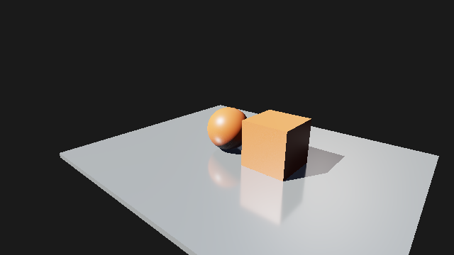

# M5：反射相机重投影与时间降噪

此记录对应最初的主表面时间滤波。用户随后反馈运动高光仍明显闪烁，当前实现与完整序列结果见 [运动反射稳定性修复](m5-reflection-stability.md)。以下旧指标与资源布局保留为历史基线，不代表当前降噪质量已满足所有场景。

日期：2026-10-27。静态不透明场景中增加相机重投影时间滤波，保留未滤波 1/N 历史与 Raw 参考。独立 Temporal Pass 在空间滤波后处理主表面历史，通过位置/法线/粗糙度逐 tap 验证、邻域 RGB 裁剪、视角衰减和最多 16 的像素历史长度限制拖影。完整契约、失效、内存和限制见 [接口](../temporal-reflections.md)。

Final/HDR 默认叠加空间和时间滤波。面板 **RT denoise (Final / HDR)** 是主开关，**Temporal reprojection (requires denoise)** / `--temporal-denoise on|off` 可回到空间基线；`--denoise off` 关闭两者。Raw / History 始终未滤波，Denoised 显示滤波结果。Camera 移动仍重置未滤波 spp，独立时间来源可继续；Temporal source 计数不表示 GPU 接受像素数。

## 移动图像对照

RTX 5060 / NVIDIA591.74；640×360、128² 阴影、validation on。以下为 Release。固定场景方向光提高到原来的 4 倍，RayTracing 样例即 3→12；原资产未修改。每组先在相同初始姿态预热 8 帧，然后连续 16 帧局部平移和偏航。慢速每帧 x=.02/yaw=.15°，快速 x=.08/yaw=.8°。相机运动时当前未滤波均值为 1 spp，但序列继续，不反复采样零。三个模式都从清空状态和同一序列开始。

终点各自用未滤波 2048 spp 图像作为参考。MSE 是最终 8-bit sRGB RGB 分量误差，不是 HDR 方差；参考包含终点所用样本索引，不是独立真值。终点误差下降不等价于对整个序列闪烁/拖影的定量保证。

| 后端 | 移动 | 未滤波 MSE | 仅空间 MSE | 空间+时间 MSE | 相对仅空间下降 |
| --- | --- | ---: | ---: | ---: | ---: |
| dx12 | gentle | 19.323594 | 9.666502 | 7.584116 | 21.54% |
| dx12 | fast | 18.089126 | 9.129517 | 6.664417 | 27.00% |
| vulkan | gentle | 19.316156 | 9.663779 | 7.581503 | 21.55% |
| vulkan | fast | 18.083220 | 9.128948 | 6.664193 | 27.00% |

样例强光慢速/快速终点误差在两后端分别约下降 21.5%/27.0%。Debug 中另一个 Pbr 场景的结果也保留于 summary.json；没有把这些输入的改善外推到任意场景。

快速移动，空间滤波：


同一终点，空间加时间：


同一终点，未滤波 2048 spp：



白点仍未完全消失。主表面重投影没有反射虚拟位置，镜面/视角依赖高光仍可能出现拖尾，邻域裁剪可能引入亮度/颜色偏差；原始均值保持独立，不能用滤波图证明积分器无偏。高 spp 时淡出滤波，两个后端的 2048 spp 时间开关 RGB 逐字节相同。慢速对应图片保留在同目录。

## 成本与内存

Release / validation off，原光强 3 的静止场景，1280×720、128² 阴影，预热 32/测量 128 帧；测量区间 33..160 spp，滤波权重随 spp 变化。单次短测，串行帧时含 CPU/提交/等待，不是窗口 FPS 或长测分布。

| 后端 | 时间关闭串行帧均值 ms | 时间开启串行帧均值 ms | Temporal GPU 均值 ms | GPU min..max ms |
| --- | ---: | ---: | ---: | --- |
| dx12 | 2.0501 | 2.2924 | 0.2190 | 0.2045..0.4217 |
| vulkan | 1.7450 | 2.0162 | 0.1331 | 0.1223..0.3460 |

时间历史增加六张 RGBA32F 持久目标（96 字节/像素），640×360 约 21.09 MiB、1920×1080 约 189.84 MiB、2560×1440 约 337.50 MiB，不含旧在途版本与 native 对齐。仅活动 View 保留这套历史，未滤波 View 缓存仍独立。关闭时间功能保留有界分配以便复用，下一次启用时来源无效；未压缩引导。

Release / validation on 的双后端 2560×1440 Player 各连续 32 帧，native ledger 高水位：

| 后端 | 高水位 MiB | 配置上限 MiB |
| --- | ---: | ---: |
| dx12 | 1141.75 | 2048 |
| vulkan | 1140.87 | 2048 |

统计不包含驱动内部/PSO/描述符全部成本，不是显卡总显存或实时可用预算；其他 GPU/4K 未验证。更多 Pass、内存和原始数值见 [summary.json](m5-temporal/summary.json)。

## 验证与复现

- Debug 所选 18 项通过（DX12 reflections 单独运行，其余 17 项一起运行）；Release AS/反射/1080p 窗口 6/6。
- `gpu.{dx12,vulkan}.acceleration_structure` 包含真实 Temporal Shader 的 9×7 非整尺寸、常量、降噪、源重置、整数/亚像素投影、出屏/深度/法线/粗糙度拒绝、亮度历史裁剪、长度上限和镜面/高 spp/背景/Unlit 旁路。
- 场景验收验证五个独立 Pass、相机移动保持兼容时间来源，同时未滤波均值重置；场景/材质/尺寸/照明/ViewID 与相机大幅跳转重置。保留既有收敛与空间隔离合约。
- 新增移动验收生成上述三模式/两条轨迹和每条 2048 spp 参考，因此 `reflections` / `ray_query_scene` 的 CTest timeout 从 120 调至 240 秒；不是性能阈值。
- 双后端持续 1080p 16 帧、1440p Player 32 帧、257×193 Denoised 诊断通过。原生 `window-test` 的重建/挂起/三管线各 54 帧、10 次重建通过；其 smoke 在渲染前已改为 640/641×360，不能当持续 1080p 验证。
- GPU/窗口/Player validation errors=0，关闭后 tracked ledger 归零。既有 clear-value/未消费顶点属性性能警告仍存在。没有动态几何运动矢量、时间矩历史或完整 SVGF/NRD；残余噪声/偏差/拖影需继续评估。

```powershell
out/build/m5-release/renderlab_sandbox.exe --backend vulkan --project sample/m4/RayTracing.rlproject --pipeline raytracing --debug-panel --temporal-denoise on
```

用方向键或 WASD 移动相机后对照时间开关。离线移动入口沿用 `--headless --scene-test --pipeline raytracing --project sample/m4/RayTracing.rlproject`；输出 `temporal-motion.json`、三模式终点 BMP 与 2048 spp 参考。参数和轨迹固定于 `reflection_temporal_motion.cpp`，validation-on 时间仅为诊断。原始文件在忽略的构建输出目录；本文 PNG 为同一 Release DX12 BMP 的无损转码。
